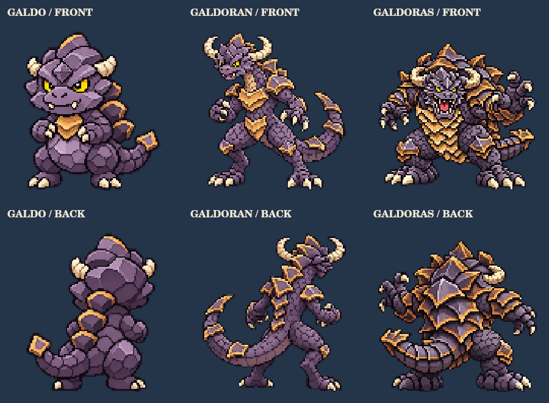

# パチモン｜Pachi Monsters

公開図鑑256種と図鑑外13種を含む全269種のパチモンと、128のステージを旅するドット絵のブラウザーRPG。64曲のBGM、32の旅紋、16の隠し要素、四境の守護者と二つの頂が待っています。PC・スマートフォン・iPad・標準マッピング対応コントローラーで遊べます。現在の版は **v78** です。

**公開ページ：<https://www.kasai-solutions-inc.com/>**

## 所持チームによるLv.50ランク対戦（v78）

冒険メニューの「ランク対戦」、またはオンライン対戦画面の「ランク対戦を開く」から参加できます。手持ち・ひかえの所持個体から異なる種類の3体を選び、「対戦相手を探す」を押すと待機します。別の待機プレイヤーとマッチすると、確認操作を挟まず、そのまま対戦画面へ切り替わります。対戦相手は実際に参加しているプレイヤーで、NPCによる自動補充はありません。

対戦中は全員Lv.50。通常個体の基礎能力をLv.50で計算し、冒険で振り分けたポイントは鍛錬による追加分も含めて減らさず反映します。ニックネーム・色違い・性別・装備中の持ち物・技の並びも引き継ぎます。フートの個別能力とカスタム技も反映し、個別能力は既存の成長式でLv.50に補正します（逆算で1未満になる能力は1）。所持している図鑑外のパチモンも選択できます。

HP・PPは全回復、状態異常なしで開始。対戦で受けたダメージや使用した持ち物は、冒険のセーブへ書き戻しません。先頭の1体から出場し、技または控えへの交代を選んで確定します。相手の行動内容は双方の確定後に解決し、100ターンで決着しない場合は残りHPの割合で判定します。

| ランク | レート |
| --- | --- |
| ブロンズ | 0〜1099 RP（初期1000 RP） |
| シルバー | 1100〜1249 RP |
| ゴールド | 1250〜1399 RP |
| プラチナ | 1400〜1599 RP |
| ダイヤモンド | 1600〜1799 RP |
| マスター | 1800 RP以上 |

近いレートの相手を優先し、初めは差100以内、15秒ごとに100ずつ広げ、90秒以上待ったプレイヤーはすべてのレートが対象になります。勝敗はElo方式（K=32、下限0）で反映し、同じレート同士の勝敗なら16 RP増減します。勝敗数・最近20件の履歴・上位50人を表示し、表示名はプレイヤー名だけを使用します。

1回の行動選択は90秒、通信が60秒途切れた側は敗北になります。双方の切断や双方未入力は無効試合で、レートを変えません。待機の取消とマッチ成立が競合した場合は、サーバーが確定した状態を表示します。再読み込み・再接続時はサーバーの対戦へ復帰し、同じ結果を二重加算しません。既に冒険のバトルが開いている場合も、その状態を保持してランク対戦画面を重ねて復帰します。

`ranked-rules.js` をブラウザーとサーバーで共有し、`scripts/sync-ranked.cjs` でサーバーモジュールを生成します。クライアントは元レベルの所持データと行動だけを送信し、能力計算・対戦処理・マッチング・レート確定はサーバーが行います。特別配布の受け取り権は既存のサーバー記録を照合します。通常の捕獲・育成・持ち物の原本は従来どおり端末内保存のため、その所持履歴全体をサーバーで証明する機能は含みません。

`server/drizzle/0010_ranked.sql` がレート・待機・対戦・行動の記録を追加します。既存データの破棄やランクリセットは行いません。

## 全プレイヤーの共通チャット（v77）

フィールド上部の「チャット」から、別のマップや秘密部屋にいるプレイヤーとも同じ会話を読んだり投稿したりできます。発言者は登録したプレイヤー名だけを表示し、運営・サブ運営・サブサブ運営の肩書きやバッジは付けません。チャットの投稿は全プレイヤーに公開されます。

最新100件を時刻順に表示し、開いている間は数秒ごとに更新します。閉じている間の新着はボタンに未読マークを表示します。PC・スマートフォン・タブレットで、履歴をスクロールしても入力欄と送信ボタンが残る専用画面を使います。画面の見える高さが変わるとチャットも追従し、入力中の方向キーやAボタンでフィールドを操作しません。

1回300文字まで。日本語の変換確定では送信せず、PCではEnterで送信、Shift+Enterで改行できます。通信に失敗した投稿は入力内容を保持し、同じ送信IDで再試行するため重複投稿を防ぎます。アカウントが変わった場合は古い画面への応答を破棄します。読み返し中に新着で勝手に最下部へ移動しません。

本人は自分の投稿を削除でき、現在の運営3役職は迷惑な投稿の削除もできます。権限はサーバーで確認し、削除済みの本文は他のプレイヤーにも返しません。全員に共通して2秒に1回・1分に10回の投稿制限を設けています。メッセージはHTMLとして実行せず、文字として表示します。

`server/drizzle/0009_global_chat.sql` が共有履歴を追加します。既存のプレイヤー情報とBearer認証を使い、冒険のセーブデータは変更しません。チャットAPI・クライアント・ゲーム入力の統合をテストし、ブラウザー上の投稿確認は公開チャットから隔離した確認データで行います。

## サブ運営・サブサブ運営の秘密部屋名（v76）

秘密部屋の入口ラベル、部屋名の初期値、訪問者向けの説明、部屋一覧を、所有者の役職に合わせます。運営は「カサイ」、サブ運営は「サカイ」、サブサブ運営は「イサカ」です。マップへ変換した後も所有者の役職を保持します。

サブ運営・サブサブ運営に保存された旧初期名「カサイのひみつ部屋」は、取得時に正しい役職の初期名として表示します。旧画面からその名前で新規作成・改名した場合も、サーバーで補正します。独自の部屋名はそのまま入口にも表示します。名前または役職だけが変わった場合も、滞在中のマップを更新します。

検証は部屋描画の3役職・カスタム名・入口ラベル、部屋作成フォーム、既存部屋の名前補正、役職変更、部屋一覧・人口一覧、既存データを変更しない読み取りを含みます。

## 秘密部屋の3テンプレートと通常フィールドと同じ視点（v75）

運営・サブ運営・サブサブ運営は、自分の部屋の「部屋を飾る」から3種類の間取りと内装を選び、「保存する」で反映できます。3つのプレビューには実際のドット絵の床・壁・ステージを表示します。

| テンプレート | 間取り・内装 |
| --- | --- |
| 王座の大広間 | 元の長方形の広間。深緑の石床と金の装飾 |
| 星環の八角堂 | 角を落とした八角形。青紫の石床と星の装飾 |
| 双翼の回廊 | 左右に広がる十字形。木床と若草色の庭園 |

家具は引き継ぎ、選んだ形で壁と重なる家具だけ、近くの空き場所へ移します。全部を置けない場合は変更せず案内します。保存前に配置を確認でき、保存せず閉じると元の部屋が残ります。部屋名・入口・対戦ステージ・中央通路も維持します。選択したテンプレートはサーバーへ保存し、訪問者にも同じ間取りを表示します。

秘密部屋を全体表示する専用の縮小処理を外し、通常フィールドと同じタイル・主人公の表示サイズと追従カメラに統一しました。部屋の端ではカメラが止まります。PC・スマートフォン・タブレットの操作ボタンとパーティー表示も継続します。

サーバーには `0008_room_templates.sql` を追加します。既存の部屋は「王座の大広間」が初期値で、保存済みの家具を引き継ぎます。各役職の本人確認・所有者・版番号・対戦中の編集制限をサーバーでも検証します。検証は `scripts/check-room-art.cjs`、`scripts/check-secret-rooms.cjs`、`scripts/check-room-bridge.cjs` とサーバーの部屋・3役職・ライブ対戦テストを使用します。

## 添付画像001・002の専用「超」タイプ（v74）

ガルド・ガルドラン・ガルドラスを現行の種族・出会い・画像の対象から外し、添付画像001を通常形態の **ルナクス**、002を進化形態の **ルナクシオン** として実装します。ルナクスはLv.48でルナクシオンへ進化します。両方とも性別なし、図鑑外で、公開図鑑256種と公開技96種の対象には含めません。

| 形態 | 種類ID | 専用タイプ | 性別 | 画像 |
| --- | --- | --- | --- | --- |
| 通常形態 ルナクス | `lunax` | 超 | なし | 添付001の二本脚の姿 |
| 進化形態 ルナクシオン | `lunaxion` | 超 | なし | 添付002の浮遊する姿 |

「超」はこの2形態だけの単独タイプです。他タイプへの技の相性は1.5倍、他タイプから受ける相性は0.75倍、超同士は1倍です。相手が複合タイプなら通常の相性計算と同じく積を取ります。冒険・オンライン対戦・運営対戦は同一の相性表を使います。

ルナクシオンは既存種の標準設定をすべて上回る基礎能力を持つ最強種です。基礎能力は体力120・物理攻撃96・物理防御92・特殊攻撃128・特殊防御112・素早さ106・命中112・回避108。通常ルナクスは順に90・64・66・88・80・72・108・106です。任意に数値を設定する運営専用フートの個別調整機能は従来のままです。4技は月輪念斬・超月光砲・月環障壁・月光再生で、すべて超タイプ。特性は超月の覇気です。

画像は `assets/lunax-user-v74.png` と `assets/lunaxion-user-v74.png`。添付の色・輪郭を保った独立した正面・背面を透過アトラスに収め、他のパチモンと同じ112pxグリッド・輪郭・陰影・色違いの描画経路を使います。

### 保存済み個体と運営3役職への反映

旧ガルド・ガルドランはルナクス、旧ガルドラス・ガルドグランはルナクシオンへ読み込み時に移行します。性別は新仕様に合わせてなしとなり、UID・ニックネーム・レベル・経験値・色違い・持ち物・育成ポイント・技の並び順・消費済みPPを引き継ぎます。新しい個体を重ねて追加する移行ではありません。

運営・サブ運営・サブサブ運営の追加配布と復元も **ルナクシオン1体、Lv.100・性別なし・鍛錬の帯・297ポイント未配分** に統一します。旧配布の受け取りIDを継続し、既に受け取った個体がある場合は移行して重複配布を防ぎます。「ルナクシオンの追加配布」から復元でき、旧画像はオフラインキャッシュからも除外します。

以下のv73以前の節は各リリース当時の変更履歴です。現行の種族・タイプ・配布条件はこのv74節を参照してください。

## START・SELECTのボタンとPCのパーティー表示（v73）

START・SELECTの操作領域全体を、明るいボタン面・濃い枠・立体的な縁を持つボタンに変更しました。PC・スマートフォン・タブレットのいずれでも、英字と日本語の機能名をボタンの中に表示します。押している間はボタンが沈み、キーボードで選択した際は枠を強調します。STARTでメニュー、SELECTで道具袋を開きます。

PCの通常の横幅では、画面の高さが低い場合も右側にパーティーを表示します。探索中のドラッグによる並べ替えに加え、戦闘中も右側で仲間のHPを確認できます。高さが少ない画面や戦闘画面では、右側をパーティー専用の表示にしてゲーム画面と操作領域を確保します。スマートフォン・タブレットと、非常に狭いウィンドウでは下部のパーティー表示を使用します。

## 押しやすい携帯機の操作配置（v72）

PC・スマートフォン・タブレットの探索画面で、十字キーとA/B、L/R、SELECT/STARTを元の携帯ゲーム機風の構成へ戻します。十字キーの各方向は44px以上、A/Bは独立した大きなボタンで、Aを右上・Bを左下に配置します。

縦画面では画面下の操作部に十字キーを左、A/Bを右、補助ボタンを中央または下段にまとめます。高さが少ない横画面では操作部を左右に分け、フィールドと重ならない専用の領域に配置します。ボタンを画面内に保ちながら、残る領域いっぱいにフィールドを表示します。

| ボタン | 操作 |
| --- | --- |
| 十字キー | 上下左右へ移動。押している間は移動を継続 |
| A | 話す・調べる |
| B | 押したまま移動するとダッシュ。キーボードでボタンを選択して決定した場合は戻る操作 |
| L / R | 地図 / 図鑑 |
| SELECT / START | 道具袋 / メニュー |

キーボード・接続コントローラーの既存の操作を維持します。回転・ウィンドウの切り替え・指を離した際は、押しっぱなしの移動を解除します。戦闘では引き続き専用のコマンド欄を使い、探索用の操作部が技や体力表示に重ならない構成です。

### 画面最下部のパーティーとスライド操作

スマートフォン・タブレットでは、操作部のさらに下、画面の最下部に手持ちのパーティーを表示します。最大6体を一列に収め、仲間の姿・名前・現在HP・HPバーを確認できます。PCの広い画面では、従来どおり右側の手帳に表示します。

探索中は、仲間のカードを押したまま左右にスライドし、移動先で離すと並び順が変わります。PCでも、右側のパーティー欄のカードをマウスで上下・左右へドラッグして並べ替えられます。移動先は金色で示し、確定した順番は自動保存します。短いタップやクリックでは仲間の詳細を開きます。戦闘中もパーティーを表示し、HPは戦闘の演出に合わせて更新します。戦闘中の交代は、既存の「交代」コマンドを使用します。

入力と保存の検証は `node scripts/check-party-strip.cjs`、画面構造と回転は `node scripts/check-responsive-fit.cjs`、タッチ入力は `node scripts/check-mobile.cjs`、オフラインへの更新は `node scripts/check-offline.cjs` で確認します。実際の配置とドラッグ操作は `tools/viewport-check.html` の端末別表示で確認できます。

## ガルドからガルドラスへ育つ3段階の系譜（v71）

図鑑外の石・土の系譜を **ガルド → ガルドラン → ガルドラス** の3段階にします。最初の姿と第一進化の姿を追加し、これまでのガルドラスを最終進化として維持します。

| 形態 | 種類ID | 進化条件 |
| --- | --- | --- |
| 初期形態 ガルド | `galdo` | Lv.24でガルドランへ |
| 第一進化 ガルドラン | `galdoran` | Lv.48でガルドラスへ |
| 最終進化 ガルドラス | `galdoras` | 以降の進化なし。Lv.100まで育成可能 |

初期形態の画像は `assets/galdo-user-v71.png`、第一進化は `assets/galdoran-user-v71.png` を使います。最終形態は `assets/galdoras-user-v70.png` を引き継ぎます。画像の制作・使用経緯は [LICENSES.txt](LICENSES.txt) に記録しています。



3形態とも図鑑外の仲間です。公開図鑑と通常探索の野生出現には追加しません。公開図鑑256種、図鑑外14種を合わせて全270種となります。石・土の複合タイプ、特性「巌王の甲殻」と4つの専用技を共有し、公開96技・図鑑外専用8技・合計104技は維持します。最終ガルドラスの基礎能力値も変更しません。

### 以前の個体と運営の追加配布

既に所持しているガルドラスは、最終形態のまま育成内容を引き継ぎます。廃止したガルドグランを再追加せず、その旧保存個体は最終ガルドラスへ移行する互換処理を維持します。旧追加配布の受け取り記録も継続し、同じ受け取り権利による重複追加を避けます。

運営・サブ運営・サブサブ運営への追加配布は、引き続き **最終ガルドラス1体、Lv.100・オス・鍛錬の帯・297ポイント未配分** です。初期ガルドやガルドランへ置き換えません。現在の運営権限と保存済みの所持個体を確認し、ひかえに空きがあるときに追加します。専用の **「ガルドラスの追加配布」→「ガルドラスをひかえに復元」** では、今回の配布個体が手持ち・ひかえの両方にいない場合に限り、同じ初期状態へ復元できます。

### タイトル画面と公開図鑑

v69・v70のタイトルを1画面内に収める設計と、「世界と遊び方」のウィンドウから説明・FAQを開く操作を引き継ぎます。公開図鑑256種の個別ページ、技一覧、攻略ガイドとトップの検索情報は、更新後のゲームデータから生成します。図鑑外の3形態の個別公開ページは作らず、従来の旧6URLから公開図鑑への転送も維持します。

**以下のv70以前の節も当時の変更履歴です。現行仕様は冒頭のv74節を参照してください。**

## ガルドラスを進化しない図鑑外の筆頭に統一（v70）

今回提供された画像の姿を **ガルドラスの唯一の通常形態** として採用し、図鑑外の筆頭をガルドラス1種に統一します。ガルドグランの種族データ、ガルドラスの進化先・Lv.50進化条件、手動進化の操作を取り除きます。ガルドラスは進化せず、Lv.100まで育ちます。正面と独立した背面を収めた透過PNG `assets/galdoras-user-v70.png` を使用し、画像の制作・使用経緯は [LICENSES.txt](LICENSES.txt) に記録しています。

石・土の複合タイプ、特性「巌王の甲殻」、4つの専用技は維持します。基礎能力値も元のガルドラスの **体力66・物理攻撃46・物理防御44・特殊攻撃26・特殊防御36・素早さ18・命中100・回避100** を使います。公開図鑑は256種のまま、図鑑外12種を含む全268種です。技は公開96種、図鑑外の専用8技を含めて104種を維持します。

### 以前の個体と育成を引き継ぐ

以前の保存データにいるガルドグランは、読み込み時にガルドラスへ移行します。同じ個体としてUID、ニックネーム、レベル、性別、色違い、持ち物、振り分け済みの能力ポイントと追加育成ポイントを引き継ぎます。旧バージョンで受け取った個体を捨てたり、育成をやり直したりする必要はありません。進化形の基礎能力値は使わず、ガルドラスの基礎能力値を使います。現在の体力が新しい最大体力を超える場合は上限へ調整し、上限以下の体力や瀕死の0はそのまま引き継ぎます。

### 運営3役職の追加配布と復元

運営・サブ運営・サブサブ運営への追加配布対象も **ガルドラス1体** に統一します。3役職とも **Lv.100・オス・鍛錬の帯・297ポイント未配分** の条件を維持します。297ポイントは通常の198ポイントと、Lv.1から鍛錬の帯で99回レベルアップした相当の99ポイントを合わせたものです。

受け取り済みの追加配布個体とその記録も引き継ぎ、同じ追加配布で重複した個体を増やさない設計です。今回の個体が手持ち・ひかえの両方からいなくなった場合は、**「設定」→「カサイ／サカイ／イサカの運営管理」→「ガルドラスの追加配布」→「ガルドラスをひかえに復元」** で復元します。復元されるのは上記の初期状態です。受取後の改名や育成内容まで戻したい場合は、冒険記録のバックアップを利用してください。現在の運営権限とひかえの空きを確認し、冒険開始前や戦闘・交換中は受け取りを保留します。

### 1画面のタイトルと公開ページ

v69のタイトルを1画面内に収める設計を引き継ぎます。PC・スマホの表示領域に合わせてタイトル画像と操作を配置し、説明・FAQ・図鑑への案内は「世界と遊び方」のウィンドウから開きます。長い内容はウィンドウ内で読めるようにします。

公開図鑑・技一覧・攻略ガイドとトップの検索情報は、更新後のゲームデータから再生成します。公開図鑑256種と図鑑外12種を区別し、ガルドラスや旧ガルドグランの個別公開図鑑ページは作りません。従来の公開図鑑の旧6URLから現在の掲載先への転送は維持します。

**以下のv69以前の節は、各バージョン当時の変更履歴です。ガルドグランや進化に関する旧記載より、上のv71の仕様を優先してください。**

## タイトルを1画面いっぱいに表示（v69）

- PC・スマホ・タブレットでタイトルを表示領域へ固定し、下へスクロールして説明が現れないようにしました。
- PCの横幅1800px制限を外し、画像と操作パネルを画面全体に広げています。タイトル・ボタンは各表示領域の幅と高さに合わせて拡大します。
- スマホ縦では画像の下へ操作を配置し、低い横画面では左右に配置します。主な操作を優先し、長い説明は「世界と遊び方」から開くウィンドウにまとめています。
- 「世界と遊び方」はPC・スマホとも表示します。説明・FAQ・図鑑等へのリンクはこのウィンドウから引き続き読めます。タイトルへ戻るときはウィンドウだけを閉じます。
- 画面内の情報ウィンドウと図鑑・攻略ガイドの独立ページは、内容を読めるようスクロールできます。冒険記録や配布個体の仕様はv68から変更していません。

## 画面の分離設計とガルドグランへの進化（v68）

### PCとスマートフォンの画面設計

キャラクターを描く領域と、ステータス・文章・操作ボタンを置く領域を分ける設計に見直しました。冒険中の場所名・操作案内、戦闘の敵味方情報・コマンド・レベルアップ表示を、キャラクターの上へ重ねず独立した領域へ配置します。横に広い画面では隣り合う配置、狭い画面では縦方向の配置を使い、画像の比率を保ちます。

表示領域の幅と高さ、画面の向き、ブラウザーの可視領域とセーフエリアに合わせて配置を調整する設計です。長い技名や能力表示は折り返し、技一覧・冒険メニュー・会話等の長い内容は各領域内でスクロールします。タイトル画面もイラストと説明・開始ボタンを別の領域に分けます。この節は画面の設計を記録したもので、すべての実機での検証完了を示すものではありません。

### ガルドラスからガルドグランへ

ガルドラスの現在の姿を通常形態として残し、**Lv.50から進化する「ガルドグラン — 地層の巨碑王」** を追加します。黒曜石と赤銅の六脚という特徴を受け継ぎ、背中の石碑と脚が発達した進化形です。石・土の複合タイプ、特性「巌王の甲殻」、4つの専用技を受け継ぎます。

- 通常の経験値獲得に加え、既にLv.50以上のガルドラスは、Lv.100の個体も含めて仲間詳細から進化を選べる設計です。「とどまりの小石」を持っている場合は、外してから進化します。
- ガルドラスとガルドグランはいずれも図鑑外です。公開図鑑は256種を維持し、図鑑外13種を含むゲーム全体は269種になります。公開技は96種、図鑑外の専用8技を含めて104種です。
- ガルドグランの正面・背面には、`assets/original-galdogran-v68.png` の1枚の透過PNGを使います。通常形態の `assets/original-galdoras-v67.png` を参照して生成した経緯は [LICENSES.txt](LICENSES.txt) に記録しています。

### 運営3役職への追加配布と専用復元

現在の運営・サブ運営・サブサブ運営の登録を確認し、それぞれのひかえへ **ガルドグラン1体を、Lv.100・オス・鍛錬の帯を持った状態** で追加する設計です。Lv.1から帯を持って99回レベルアップした育成相当として、通常198ポイントと鍛錬99ポイントの合計 **297ポイントを未配分** で受け取れます。

初回は起動後のお届けもの同期で受け取りを確認します。冒険の開始前、戦闘・交換中、ひかえに1体分の空きがない場合は保留します。v64の育成済み6体とは別の追加配布として管理し、既存の手持ち・ひかえ・受け取り記録を上書きしません。

**「設定」→「カサイ／サカイ／イサカの運営管理」→「ガルドグランの追加配布」→「ガルドグランをひかえに復元」** から、今回の追加配布個体が手持ち・ひかえの両方にいない場合に限って復元できます。同じ受け取りIDの個体が既にいるときは重複追加しません。復元はLv.100・オス・鍛錬の帯・297ポイント未配分の初期状態であり、受取後の改名や配分等まで戻す場合は冒険記録のバックアップを使います。受け取り・復元とも、その時点の運営権限を確認します。

### 公開ページと検索情報の更新

正規URLを **`https://www.kasai-solutions-inc.com/`** にそろえ、トップ、公開図鑑、個別図鑑、技一覧、攻略ガイドの説明と構造化データを更新しました。公開図鑑とゲーム全体の種数、公開技と非公開の専用技を区別し、石を含む公開9タイプを案内します。件数はゲームデータから生成するため、図鑑外の追加を公開図鑑の収録数として扱いません。

- canonical、OGP、Twitterカード、JSON-LD、サイトマップ、内部リンク、画像参照、viewport、index/noindexの整合を検証します。共有画像は1200×630の紹介画像とし、実際の画像寸法をメタ情報へ記載します。
- 見えるFAQを残し、Googleで2026年5月に終了したFAQリッチリザルト向けの`FAQPage`生成は終了しました。架空のレビューや評価は追加しません。根拠は [Google Search Centralの更新履歴](https://developers.google.com/search/updates) です。
- 更新日は生成を実行した日だけでは変更しません。本文・メタ情報・参照URL等の実質的な変更を `scripts/seo-page-state.json` に記録し、ページの更新日とサイトマップの`lastmod`をそろえます。
- `node scripts/build-seo-pages.cjs` で生成し、`node scripts/check-seo.cjs` で検証します。検索への登録、検索結果での表示方法、掲載順位を保証するものではありません。

**以下のv67以前の節は、各バージョン当時の変更履歴です。現在の仕様は上のv71節を参照してください。**

## 姿と共鳴の表現を見直し（v67）

既存作品との印象の重なりを減らすため、ガルドラス・フート・無属性3形態・潮氷3形態・真珠3形態の計11種を、新しい構造とシルエットで描き直しました。5枚の透過PNGから正面と背面を別々に表示し、読み込み中や失敗時にも旧デザインへ戻しません。フートの公開図鑑・運営用サムネイルも同じ新しい姿にそろえています。

仲間になる道具を**共鳴鈴**とし、鈴の響きに応答して絆を結ぶ説明・演出へ統一しました。戦闘の主操作は「技を選ぶ」を上段に置き、「相棒交代」「旅道具」、野生戦の「共鳴」「距離を取る」を組み合わせます。「四境の守護者」「星路の継承者」「天頂の覇者」「調律士」の用語で世界の案内をそろえます。

種類ID・名前・図鑑の範囲・能力・技・進化・育成・手持ち・ひかえ・セーブ形式は引き継ぎます。共鳴の成功率、鈴の消費数、対戦ルール、運営機能も変えません。旧専用画像は現行の公開ファイルとオフライン一覧から外し、更新時には該当する画像キャッシュだけを整理します。

監査の範囲と判断、画像の新しいコンセプト、音源の来歴と確認していない権利は [独自性の見直し記録](docs/originality-v67.md) と [LICENSES.txt](LICENSES.txt) に記載しています。この変更は、旧素材の法的な侵害認定や、新素材の非侵害保証を意味しません。

**以下は各バージョン当時の変更履歴です。旧画像や旧名称に関する記載は、現在のv71の仕様とは異なる場合があります。**

## 全パチモンの輪郭・模様とドット感を強調（v66）

図鑑256種と図鑑外12種の全268種で、輪郭と体の模様を濃くし、ドットを一段粗く表示します。共通の描画グリッドを160から112へ変更し、透明な外側へ輪郭を広げずに、体の内側の縁と既存の暗い模様を強調します。目の光や白い毛・装甲の明るさを残し、色違いにも同じ処理を適用します。

正面・背面・通常色・色違いの1,072通り、ソロと通信対戦、手持ち・ひかえ・ゲーム内図鑑・交換プレビューに共通で反映します。公開図鑑の256枚の画像と運営画面のフートも同じ描画処理から出力し、各画面の見た目をそろえます。原画・種類・技・能力・育成・セーブ形式はそのままです。

画像の処理結果は元画像ごとにキャッシュし、毎フレームの再処理を避けます。公開図鑑の画像は `node scripts/build-dex-sprites.cjs` で再生成でき、従来の `python3 scripts/build-dex-sprites.py` も同じ処理へ転送します。

## 石タイプと図鑑外の筆頭・ガルドラス（v65）

新タイプ **「石」** と、**石・土の複合タイプ「ガルドラス — 巌冠の覇王」** を追加します。添付された姿を持つ、体力・物理攻撃・物理防御に優れた重装のパチモンです。進化はなく、Lv.100まで成長します。図鑑外の筆頭として扱い、公開図鑑・収集課題・通常の野生出現には追加しません。図鑑は256種のまま、図鑑外12種を含む全268種になります。

特性 **「巌王の甲殻」** は物理攻撃技で受けるダメージを20%減らします。特殊攻撃や状態異常のダメージは減らしません。基礎能力値は体力66・物理攻撃46・物理防御44・特殊攻撃26・特殊防御36・素早さ18・命中100・回避100です。

| 専用技 | タイプ・分類 | 威力 | 命中 | PP | 効果 |
| --- | --- | --- | --- | --- | --- |
| 巌冠砕牙 | 石・物理 | 70 | 95 | 8 | 防御技によるダメージ軽減を貫通 |
| 地殻崩断 | 土・物理 | 90 | 90 | 5 | 命中後、次の1ターンは技と交代ができない |
| 金剛の構え | 石・防御 | — | 100 | 6 | 次に受ける攻撃技を半減。貫通技は防げない |
| 地脈再生 | 土・回復 | — | 100 | 6 | 自分の最大体力の半分を回復（端数切り上げ、最大体力が上限） |

**入手方法：冒険中に「設定」→「カサイ／サカイ／イサカの運営管理」→「裏技・幻の草むら」→「ガルドラス」** を選び、Lv.1〜100・性別・色違いを指定して出会います。運営・サブ運営・サブサブ運営の3役職が既存の権限確認を経て使えます。選択欄では「図鑑外・筆頭」として先頭に表示します。パチカプセル1個で捕獲でき、自動配布は行いません。

所持している個体はオンラインのシングル・ダブルにも編成でき、既存のLv.50補正と育成ポイント配分を引き継ぎます。未所持のレンタル候補や交換対象には入りません。セーブ・ひかえ・ニックネーム・技の並べ替えも既存の仕組みを使います。

石は風・氷に1.5倍、芽・潮に0.7倍。逆に芽・潮から石へは1.5倍、風・氷から石へは0.7倍です。石同士は0.8倍、他のタイプとは1倍です。ガルドラスの石・土への攻撃は2タイプの相性を掛け合わせるため、芽と潮を苦手とします。既存8タイプ間の相性と、無タイプの等倍・状態異常耐性は維持します。石の破片と金色の縁を使った技の演出、岩が砕ける効果音を追加しています。

正面の `assets/galdoras-front-v65.png` はユーザー提供の透過PNGをそのまま使用します。背面の `assets/galdoras-back-v65.png` は同じ正面を参照し、組み込み画像生成で独立して制作した透過画像です。生成指示の要点は「同一個体の紫灰色の岩鎧、金の縁、湾曲した双角、太い四肢と鎧の尾を維持した、右向き後方3/4の全身ドット絵。実際の背中を描き、透明背景、文字なし」。正面と背面を別々に読み込み、前後を反転画像で代用しません。

## 運営3人の育成済みメンバーと復元（v64）

現在の運営登録を確認し、各端末のひかえに次の6体を追加します。全員Lv.100、鍛錬の帯を持った状態です。

| 役職 | 性別（6体共通） | メンバー |
| --- | --- | --- |
| 運営カサイ | オス | コモリゼン・キラシード・ゼロヴェイル・パルセリア・ヒョウガルド・ルリゴルム |
| サブ運営サカイ | メス | シズナリア・キラシード・ゼロヴェイル・パルセリア・ヒョウガルド・ルリゴルム |
| サブサブ運営イサカ | オス | アケホムラ・キラシード・ゼロヴェイル・パルセリア・ヒョウガルド・ルリゴルム |

- Lv.1から鍛錬の帯で99回レベルが上がった状態を再現します。通常198＋帯の99で、各個体の振り分けポイントは **297ポイント（未使用）**。能力への配分は各運営が決められます。
- 初回は次の起動・お届けもの同期でひかえへ追加します。冒険が未開始、戦闘・交換中、ひかえに必要数の空きがない場合は保留します。既存の手持ちやひかえは上書きしません。
- **「設定」→「カサイ／サカイ／イサカの運営管理」→「Lv.100の運営メンバー」→「足りないメンバーをひかえに復元」** で、受け取り済みでも現在所持していない指定個体を復元できます。
- 同じ受け取りIDが手持ちかひかえにある個体は重複追加せず、ニックネーム・能力配分・持ち物・技の並びなども保持します。通常捕獲した同種や、従来の初期キラシードとは別の個体です。
- 復元で戻るのは今回の初期状態です。再配分・改名などを行った後の状態まで戻すには、通常の冒険記録を書き出して保管してください。別端末では元のプレイヤー情報を復元するか、その端末のプレイヤーIDを運営に登録してから受け取ります。
- 通信対戦は既存のLv.50補正を使い、割り振った297ポイントと指定の性別を引き継ぎます。運営のリアルタイム対戦にも編成できます。一般プレイヤーの受け取り・復元画面には表示しません。

## 通常戦闘BGMを2分05秒でループ（v63）

- 提供された「CIGNA shorts short shortsvideo shortvideo (1)(2).mp3」の **0:00〜2:05（125秒）** を通常戦闘BGMとして繰り返します。
- 48kHzステレオのMP3に切り出し、両端5ミリ秒の短いフェードでループ境界のクリック音を抑えます。音楽室22番の再生時間と説明も2:05に合わせました。
- 端末の音量・ミュート、戦闘終了時の場面切替、運営専用BGMの優先順位は引き継ぎます。新しい音源URLとサービスワーカーにより、旧音源のオフラインキャッシュも更新します。

## 初回音量10・3人の運営（v62）

- 初めて遊ぶ端末の音量は **10 / 100**。タイトルBGMが鳴る前から適用し、以前に保存した音量・ミュート設定は引き継ぎます。
- **運営・サブ運営・サブサブ運営の3枠**を用意します。メイン運営が **「カサイの運営管理」→「運営端末」** で空いている役職と別端末のプレイヤーIDを指定し、登録先を確認します。登録先の端末では「設定」のプレイヤー情報からIDを確認します。
- 3人ともフートの能力設定・配布、運営限定の仲間、裏技の草むら、専用部屋・リアルタイム対戦を使えます。権限はサーバーの現在の登録から判定します。
- サブ運営は紫の長い髪・編み込み・黒いロングコート、サブサブ運営は金髪・白系のロングコートの専用ドット絵です。ユーザーの添付デザインをもとに4方向の待機と歩行を用意し、本人・ほかの端末・人物紹介に同じ姿を表示します。サブ運営の表示名は **サカイ**、サブサブ運営は **イサカ** に固定します。解除後は保存してある通常のプレイヤー名と姿へ戻ります。
- メイン運営は、登録済みのサブ運営・サブサブ運営をいつでも確認画面から解除できます。両方ともメイン運営や他端末の登録は解除できません。解除した端末の新しい運営操作は拒否し、冒険の記録・配布済みの仲間・通常の部屋は保持します。
- 一般プレイヤーに追加の運営登録入力欄は表示しません。3枠の登録がそろった後は、メイン運営の追加用入力欄も非表示になります。解除後は空いた役職に別の端末を登録できます。

3人はそれぞれ別のプレイヤーIDを使います。同じプレイヤー情報ファイルを複数端末へ復元する必要はありません。登録後、追加した端末でプレイヤー情報を再確認するかページを再読み込みすると、運営機能が使えるようになります。冒険中はフィールドの同期でも役職の変更を検出し、名前・専用の姿・運営メニューを切り替えます。古い通信応答が、解雇後の権限を表示上で戻さないようにします。

メイン運営が自分の登録を解除する場合は、サブ運営を優先し、登録されていなければサブサブ運営がメイン運営を引き継ぎます。確認画面で引き継ぎを説明し、運営登録が残る間は一般のキー入力を表示しません。

## PCの画面FIT（v61）

- 冒険画面は起動時からブラウザーの縦横に合わせて表示。ゲーム機・操作ボタン・冒険メニューがページのスクロールなしで収まります。
- PCのゲーム機ボタンは下部にまとめ、液晶画面を広く使います。ウィンドウのサイズ変更やブラウザーの拡大率変更にも自動で追従します。
- 戦闘中は相手・仲間のステータスとコマンドを右側に配置。キャラクターの上に操作パネルが重ならず、画面比率が変わっても絵が横伸びしません。
- 右上の「拡大FIT」で、余白と冒険手帳を減らした大きな画面へ切り替えます。ブラウザーの全画面表示に対応していない環境でもページ内で拡大でき、もう一度押すと通常FITに戻ります。
- 高さの低いPCウィンドウでの戦闘は、敵と味方の情報を横並びにして技・交代・道具の領域を確保します。通常FITでも「戻る」まで表示できるよう、本体の操作欄も高さに合わせてコンパクトになります。
- 小さなウィンドウでは手帳をたたみ、道具袋・地図・図鑑などは本体ボタンやメニューから開けます。長い一覧は各ウィンドウ内でスクロールできます。

## 収録内容

| 項目 | 内容 |
| --- | --- |
| モンスター | 図鑑256種（通常253種＋伝説アルヴェリオン＋運営配布限定フート＋カサイ勝利報酬の幻キラシード）と図鑑外12種、合計268種。捕獲・育成・進化 |
| ステージ | 128。子午線（第1〜64）と卯酉線（第65〜128）。4ステージ（町・道・名所・深部）で1地方、全32地方 |
| 紋章館と旅紋 | 32人・32種類。各地方の町に1館。順番に攻略して次の地方を開放 |
| 四境の守護者・チャンピオン | 四境の守護者4人＋チャンピオン2人（第64ステージ「星路の継承者」、第128ステージ「天頂の覇者」） |
| 隠し要素・裏技 | 16の隠し要素と8つの裏技バグ。メニュー「冒険の記録 256→1」にヒントと発見状況を表示 |
| 通常CPU調律士 | 126人（各ステージ1人。最初の町・評議院・天頂を除く）＋裏部屋の番人 |
| 建物の室内 | 128ステージとは別に104室。紋章館・宿・道具店・研究所・住宅、隠し部屋2室 |
| BGM | 音楽室64曲。タイトル曲「愛しているから」は16ビット風アレンジ、フィールド「正義の心我らに」と通常戦闘は提供MP3を原音で共通再生。カサイ戦は「Pop Man -One Light-」。音楽室の録音3枠と既存曲61枠を維持 |
| ステータス | 体力・物理攻撃・物理防御・特殊攻撃・特殊防御・素早さ・命中・回避 |
| 属性 | 公開タイプは芽・潮・灯・風・晶・雷・氷・土・石の9種類。石・土のガルドラスを含め、一部は2属性の複合タイプ。図鑑外の無は単独タイプ |
| 特性 | 全268種に種族ごとの特性を1つ。条件に応じて自動で発動し、冒険・通信シングル・ダブルへ共通適用。既存の手持ち・ひかえにも自動反映 |
| 技 | 公開96種類（一般技75種＋無属性6種＋特別な技15種）と図鑑外専用8技、合計104種類。各モンスターの技は4つ。個体ごとに技の順番を変更できる。最初の相棒は二段進化で特別な技を習得 |
| パーティ | 同行1〜6体。「ひかえに送る」で人数を調整できる。ひかえ192体、レベル上限100。以前の版で193〜512体を保存している場合も全員を保持 |
| オンライン対戦 | 招待リンクまたは6文字のルームコードでプレイヤー1対1。シングル・ダブル。冒険の手持ち・ひかえからチーム編成（Lv.50にそろえる）。振り分け・持ち物・状態異常を反映 |
| オンライン交換 | 部屋をつくって招待リンクを共有。相手はリンクから参加し、お互いのパチモンを確認して交換。6文字のコードによる参加も可能 |
| ローカル通信 | 同じWi-Fiにつないだ近くの端末と、QRコードを互いに1回ずつ読み取って対戦・交換。ゲームを事前に読み込めばインターネット回線は不要。Wi-Fiテザリングや対応端末のBluetoothテザリングも利用可能。テザリングなしのBluetooth直接通信はブラウザー版では未対応 |
| オフライン | 一度開けば通信なしで冒険を開始。ホーム画面に追加してアプリのように起動 |
| フィールド交流 | ソロ冒険中は常時ON。同じエリアの実プレイヤーを表示し、近づいて対戦・交換へ招待。通信復帰時は自動再接続 |
| 運営・配布 | 運営カサイ・サブ運営サカイ・サブサブ運営イサカの3つのプレイヤーID。「謎のトレーナー カサイ」の専用歩行ドットと戦闘BGM。全268種の幻の草むら、フートの設定・配布 |
| 技エフェクト | 24種類を基に公開96技と図鑑外専用8技に割り当て。フートの拳・光線・覚醒・再生、ガルドラスの巌冠と地殻の演出を含む |
| 状態異常の演出 | 6種類（花毒・水封・灯焼け・目眩・結晶化・呪縛）と、水封・結晶化が解けるときの2種類。かかっている間は毎ターン表示 |
| 追加要素 | 訪問済み地域への移動、紋章館再戦、依頼、50階の塔、昼夜、描画品質設定 |

通常調律士126人に加え、紋章守32人・四境の守護者4人・チャンピオン2人・裏部屋の番人の計165人と対戦できます。野生戦では相手のHPを減らし、パチカプセルを使って仲間にします。物理わざは攻撃・防御、特殊わざは特攻・特防、行動順は素早さ、命中判定は命中・回避で変わります。

建物の扉に歩くと入室し、室内の出口から外へ戻れます。道具店では購入、宿では無料回復、紋章館では旅紋への挑戦ができます。子午線の16旅紋で第64ステージ「子午線評議院」が開き、四境の守護者を順に倒した後、星路の継承者に勝つと卯酉線へ渡れます。卯酉線の16旅紋（合計32）を集めると、第128ステージ「天頂の交点」で天頂の覇者（Lv.100）と戦えます。

## オンライン人数一覧（v58）

フィールド外の操作欄にある **「オンライン一覧」** から、ステージ別の接続人数を開閉できます。自分を含む世界全体・現在地の人数を表示し、一覧を開いている間だけ約5秒ごとに更新します。接続中の場所を初期表示し、検索や全ステージ表示にも切り替えられます。秘密部屋も人数を集計します。15秒以上更新されていない接続情報は除外されます。

スマホでは接続情報と交流操作を画面外のコンパクトな欄にまとめ、フィールドのキャラに重ならないようにしました。

## 秘密部屋・カサイとのリアルタイム対戦（v59）

ソロ冒険で作成可能な壁を向き、**画面のAボタン・コントローラーの決定・キーボードのE / Enter / Space** を押すと秘密部屋の操作が開きます。初回は名前を決めてその壁に作成し、すでに自分の部屋があれば移転先の確認へ進みます。運営も同じ操作で好きな有効な壁を選び、風待ちの里への自動作成や専用の予約壁はありません。「秘密部屋」ボタンや冒険メニューからも管理できます。

秘密部屋のある壁には**ドット絵の入口マークと部屋の案内**を表示します。その壁の前で **A / E** を押すと入室できます。同じエリアの部屋一覧からも訪問でき、持ち主の承認は不要です。部屋の中でも交流は常時ONです。入口はサーバーに保存され、再読み込み後も残ります。

運営は **「カサイの部屋を飾る」** で専用ステージもデコレーションできます。自分の部屋は外からも編集できます。

自分の部屋では **「家具を飾る」** から植物・ランプ・椅子・テーブル・ソファ・本棚・ベッド・水槽・結晶・ぬいぐるみ・ラグ・壁飾りの12種類を最大32個まで配置できます。家具は無料で、場所の変更・90度ずつの回転・片付け・部屋名の変更に対応します。編集は持ち主だけが行い、保存すると訪問者にも反映されます。入口、中央の通路、カサイの舞台は家具で塞げません。別タブの編集が先に保存された場合は競合を表示し、変更を上書きしません。

部屋は運営・一般プレイヤーとも **一人一室** です。別の作成可能な壁を向いて **A / E** を押すと、移転先の確認が開きます。**「この壁へ移転する」** を選ぶと、同じ部屋ID・名前・家具配置を引き継ぎ、入口だけを移します。古い壁の入口マークは消え、新しい壁に表示されます。すでに室内にいる訪問者は入室時の安全な帰り道を保持します。カサイの対戦ステージを使用中は移転・模様替えができません。

フィールドの **「謎のトレーナー カサイ」** 本人に話しかけて **「カサイとバトル」** を選ぶと、接続中の運営と挑戦者が同じ対戦ホールへ移動します。運営は先に自分の秘密部屋を作っておきます。部屋が未作成、運営がオフライン・操作中・対戦中なら開始しません。運営本人は自分に挑戦できません。秘密部屋一覧からの通常訪問では対戦を開始しません。

カサイは奥の固定位置で手前を向き、挑戦者は手前から奥を向いて入室します。**入室開始から60秒以内** に挑戦者がカサイの隣まで歩いて話しかけると、運営側に対戦許可が表示されます。運営が許可すると、専用BGM「Pop Man -One Light-」でリアルタイム対戦を開始します。話しかけないまま60秒経つと、双方をそれぞれのフィールド位置へ戻します。カサイは対戦終了後も挑戦者が退出するまで固定位置から動けません。挑戦者の退出、運営の不許可、接続切れ、運営の交代でもセッションを解放し、復帰時にも安全な場所へ戻します。

双方の保存済み手持ち1〜6体を入室時に確定し、人数・並び順・レベル・技・育成・個体の見た目と、設定したフートの能力をそのまま使います。双方のHP・PPは開始時に回復します。毎ターン両者が選んだ技または交代がそろってからサーバーで同時解決し、相手の未確定コマンドは公開しません。勝敗・交代・状態異常は同じ戦闘ルールで計算します。冒険の手持ちを戦闘中の状態で上書きしません。

勝利した挑戦者には、プレイヤーIDごとに一度だけ **Lv.70のキラシードを1体** 贈ります。性別はサーバーでオス・メスからランダムに決め、再試行でも変えません。**ひかえが192体以上なら、手持ちに空きがあっても受け取れません。** 空きを作って「報酬を受け取る」で再確認できます。受取済みの個体を逃がしたり古いセーブを読み込んだりしても、二体目は配布しません。旧ソロ版で確定済みの報酬と受取記録は引き継ぎます。

リアルタイム対戦の勝利はサーバーで実際に計算した結果から判定します。端末にセーブを書き込んでから受取完了を送信するため、通信失敗時も重複せず再確認できます。部屋にいる間の保存先は安全なフィールド位置で、通信できない状態で再開しても室内に閉じ込められません。

検証: `check-kasai-live-engine`、`check-kasai-live`、`check-room-art`、`check-secret-rooms`、`check-room-bridge`、`check-field-world` とサーバーの部屋・ライブ対戦テスト。サーバーには `0003_rooms.sql`〜`0005_kasai_live.sql` と、ブラウザーと共有する静的戦闘ルールを使用しています。

## 常時ONのフィールド交流・謎のトレーナー カサイ（v55）

ソロ冒険中、同じエリアに接続している実プレイヤーをフィールドへ表示します。交流は常時ONで、自分の名前・位置・向き・行動状態を自動同期します。以前の交流OFF設定は使用しません。接続人数は同一エリアの表示対象数です。別のエリアの人や架空のオンライン人数を混ぜません。回線が途切れても冒険は続けられ、復帰後に自動でつなぎ直します。

近づいて **E / A / 話す・調べる**、または **近くの人** から相手を選び、対戦・交換を申し込みます。相手が承諾すると既存の通信画面へ進みます。対戦は双方のチーム準備を、交換は双方の個体選択と最終確認を経て開始・確定します。招待は60秒で期限切れになり、相手が離れた・取り込み中・取消済みの場合は再度申し込めます。

運営のプレイヤーはサーバーが **「謎のトレーナー カサイ」** として識別します。添付の人物を参考にした青緑の髪・クリーム色のロングコートの専用ドット絵を、前後左右と歩行に使用します。運営の本人端末でもカサイを操作でき、通常プレイヤーの選択した姿や冒険セーブは保持します。インターネット対戦では署名付きの本人確認でカサイの資格を確かめ、カサイとの戦闘に添付MP3 **「Pop Man -One Light-」** を全編ループ再生します。単に名前をカサイに変えても運営の姿・専用曲にはなりません。曲は対戦準備で読み込み、戦闘終了時に通常の場面へ戻ります。

運営管理の **「裏技・幻の草むら」** ボタンから、現在の全268種を選べます。図鑑256種と図鑑外12種、最初の相棒・進化後・伝説・運営限定をすべて含みます。検索は名前・タイプ・伝説・運営・図鑑外に対応し、検索結果からランダム選択もできます。後から種族データを追加した場合も選択肢へ自動反映します。

実装上の上限は同一エリア80人、通常時約500msの位置同期、15秒で途絶した位置を失効です。隠れたタブは通信を一時停止し、戻ると再接続します。ソロの物語・NPC・当たり判定・セーブ形式を変更せず、遠隔プレイヤーは描画と交流の対象として重ねます。フィールド招待の対戦は相手の署名付きIDまで照合し、本人確認できない場合は待機を終了して説明します。通常のコード対戦では署名サービスが利用できなくても従来の対戦を妨げません。

運営・交換サービスには `server/drizzle/0002_world.sql` を追加します。運営権限はサーバーの既存登録に従い、クライアントからの役割申告は使用しません。既存交換ルームの復旧・取引記録を保持し、フィールド交換の部屋は招待先へ予約します。通信ルールの識別子を更新したため、対戦する両端末で最新ページを読み込んでください。

主な検証: `check-secret-encounter`（全267種の捕獲・保存・再読込と将来追加種）、`check-field-world`（表示・同期と取消の競合）、`server/tests/world.test.mjs`（近接招待・署名・予約交換）、`check-kasai-online`（本人確認と対戦導線）、`check-battle-recording`（添付音源と切替）、`check-trade-ui`、`check-admin-client`、`check-offline`、人物アートと既存対戦の回帰確認。

## 全パチモンの種族特性（v53）

図鑑の256種と、図鑑外の3種を合わせた全259種に、種族ごとに1つの**特性**を追加した。攻撃・防御・行動順・状態異常などに関わる効果が、条件に応じて自動で働く。技の4枠や持ち物とは別の能力で、覚えるための操作、道具、コインは不要。同じ種族なら同じ特性を持ち、進化後は進化先の種族の特性になる。

特性は個体の保存値ではなく種族から決める。以前から手持ち・ひかえにいる仲間、配布された個体、交換した個体にも自動で適用される。個体ID、レベル、ニックネーム、色違い、技の並び順、育成状況を作り直す必要はない。冒険のバトルと通信シングル・ダブルで共通の特性定義・効果を使う。

| 確認する場所 | 表示 |
| --- | --- |
| 手持ち・ひかえの詳細、発見済みの図鑑 | 特性名と、発動条件や倍率を含む効果全文 |
| 通常バトル | 自分と相手のHP欄の下に特性名。押すと効果を確認 |
| 通信のチーム編成 | 各メンバーの特性名と効果全文 |
| 通信シングル・ダブルの戦闘 | 各パチモンの特性名を押して効果を展開 |
| オンライン・ローカル交換の確認 | 渡す個体・受け取る個体の特性名と効果全文 |
| 公開図鑑 | 各種族の基本データに特性名と効果全文 |

名称・説明はすべて共通の `LT.Abilities.get(...)` から取得する。倍率や条件の説明を画面ごとに別管理しない。特性により戦闘中だけ変わる能力・ダメージの補正は、公開図鑑の基礎能力値やタイプ相性表には含めない。図鑑外の3種には特性を適用するが、公開図鑑・種族ページ・サイトマップには引き続き掲載しない。表示は既存の高精細ドットとカラー／モノクロの2モードを維持する。

特性定義・全種の割り当ての正本は `data/species-abilities.json`、効果と配分の詳細は `docs/species-abilities-v53.md` にあります。定義を変更したら `node scripts/sync-abilities.cjs` でブラウザー用データへ反映し、`node scripts/build-seo-pages.cjs` で公開図鑑を更新します。

検証: `node scripts/sync-abilities.cjs --check`、`node scripts/check-abilities.cjs`（28特性・259種、実戦効果111比較、通常/シングル/ダブルの一致、旧保存、交代、一戦一回、決定的な通信とルール不一致拒否）、`node scripts/check-battle-health.cjs`（特性回復のHP再生）、既存のタイプ・持ち物・状態異常・進化・通信・交換・図鑑の検証。

## 雷・氷・土、複合タイプ、戦闘・フィールドBGMと高精細表示（v52）

公開属性を **芽・潮・灯・風・晶・雷・氷・土** の8種類に拡張した。既存の絵・生態・進化のつながりを確認し、66種を再分類、うち64種を複合タイプにした。御三家の全進化段階、アルヴェリオン、キラシード、フートは従来の単タイプを維持する。図鑑外の無も単独のまま。種族データからタイプを決めるため、手持ち・ひかえの既存個体へ自動的に反映される。

冒険・通信シングル・ダブルは共通の相性表を使う。有利1.5倍、不利0.7倍、同タイプ0.8倍、その他1倍という従来の倍率と、元の5タイプ間の相性を維持した。複合タイプの防御相性は2属性の積で、両方弱点なら2.25倍、両方耐性なら0.49倍。有利と不利が重なると1.05倍になる。タイプ一致はどちらか片方に一致すれば1回だけ1.15倍。通常の状態異常に対する同タイプ耐性も副タイプへ対応し、無の相性中立・全状態免疫を維持する。通信のルール照合にはタイプ配列と相性表も含める。

既存12技を雷・氷・土へ各4技ずつ再分類した。物理・特殊の両方を用意し、名前・説明・放電、氷片、土煙や岩片の演出・効果音を合わせた。技ID、PP上限、威力、各種族の4技セット、個体の技順を維持する。全259種には少なくとも1つのタイプ一致攻撃が残る。複合タイプの両方に一致する技があるとは限らず、副タイプは防御相性にも働く。レベル、個体ID、ニックネーム、振り分け、持ち物、残りPPを引き継ぎ、交換サーバーの技カタログも互換のまま。

| 対象 | v52での表示・再生 |
| --- | --- |
| フィールドBGM | 提供音源「正義の心我らに」139.632秒をファイルそのままで全編ループ再生。町・道・森・洞窟などの128フィールドで共通使用し、マップ移動・昼夜切替では再開しない。戦闘・室内・回復などでは各場面の曲へ切り替わる。音楽室15番、音量・ミュート・一時停止・オフラインに対応 |
| 全戦闘のBGM | v52では提供MP3の全編374.904秒をループ再生。v63で通常戦闘の再生範囲を冒頭125秒へ更新した。交代・ボス区分の切替では再開せず続け、終了時は探索・勝利等の場面に戻す。音量・ミュート・一時停止・音楽室・オフラインに対応 |
| モンスター | 表示用の格子を80×80から160×160へ。元画像の輪郭・色・透明度・正面/背面・色違いを維持 |
| 世界と人物 | 地形等は4pxから2px単位、人物は24×32から48×64の論理格子へ。細部を拾い、文字・判定・操作領域は維持 |
| 背景・演出・タイトル | 表示レイヤーの長辺上限を384pxから768pxへ。タイトルは縮小済み画像ではなく元の高解像度絵から表示 |
| 公開図鑑の画像 | 256枚を元アトラスから96×96へ直接生成し、80pxからの非整数拡大を解消 |
| 画面モード | **カラー / モノクロ**の2つだけ。どちらも同じ描画解像度と細かな階調を使う。旧モノクロ設定は引き継ぎ、ほかの旧モードはカラーへ統合 |
| 図鑑・手持ち・交換・通信対戦 | 2属性を表示。タイプ別の図鑑には副タイプでも掲載し、公開ページの弱点・耐性も実際の戦闘計算から生成 |

モノクロは絵のCanvasへ同じ解像度のグレースケールを適用する。文字・操作UI・QRコードの読みやすさを保つ。セーブ形式を変えず、旧記録を読み込んで続けられる。

## 世界・人物・演出・UIも共通のドット表現へ（v51）

v50のモンスター表示に合わせ、地形・建物・木・家具、主人公とNPC、戦闘背景・技や状態異常の演出、タイトル画面と操作UIにも、輪郭と陰影のドットが分かる表現を適用する。紫の携帯機外枠と青いメニューの配色、PC・スマートフォン・iPadの既存の画面配置を引き継ぐ。

| 対象 | 表示方法 |
| --- | --- |
| 地形・建物・木・家具 | 組み立てた表示用の各素材を4px単位でサンプリングし、nearest-neighborで拡大する。地形や建物の位置・当たり判定はそのまま。 |
| 主人公・NPC | 前後左右の姿と歩行フレームを24×32の論理ピクセル格子にそろえる。人物選択などの大きな表示も同じ格子を使う。 |
| 戦闘背景 | 表示用背景の長辺を最大384pxの格子で描き、画面サイズに合わせて拡大する。 |
| 技・状態異常の演出 | 長辺最大384pxの透明レイヤーへ描画して重ねる。ダメージ・回復量・状態などの文字と数字は別途、本来の解像度で描き、読みやすさを保つ。 |
| タイトルの背景絵 | 既存の絵から長辺最大384pxの表示用Canvasを作る。読み込み・Canvas作成が失敗した場合は既存の背景画像を使う。 |
| メニュー・道具・ショップ・設定・通信・対戦枠 | `world-pixels.css` で段階的な面色と硬い影、小アイコンの角のある描画に統一する。文字の画像化や画面全体へのフィルターは使わない。 |

共通処理は `scene-pixels.js` が担当し、元の画像ファイルを書き換えず、表示用Canvasだけを加工する。ゲームルール、モンスターの能力や技、持ち物、入手条件、セーブ形式は変更しない。文字・体力バー・数値・フォーカス表示・タップ領域は従来の仕組みで表示し、動きを減らす設定も引き継ぐ。QRコードとカメラ映像はUIのドット加工の対象にしない。

新しい描画処理・タイトル処理・CSSをバージョン付きURLで読み込み、オフラインのシェルにも保存する。元画像の一覧と容量は `OFFLINE_VERSION=20261119-world-pixels-v51 node scripts/build-offline-manifest.cjs` で再生成し、`node scripts/check-offline.cjs` で初回保存・オフライン起動・更新失敗時の旧資産保持・新資産への切り替えを確認する。

## 全モンスターのドット表示・キラシードの4技と能力（v50）

全259種（公開図鑑256種と図鑑外3体）の描画を、80×80の論理ピクセル格子へ統一した。共通の `monster-pixels.js` が元の姿・配色・透明度を保ちながらnearest-neighborで表示用画像を作り、拡大時にも色を混ぜず、輪郭と陰影のドットを明瞭にする。正面・背面・色違い・読み込み待ちの仮表示、手持ち・図鑑・連れ歩き・冒険の戦闘・通信シングルとダブルへ共通で反映する。元画像と個体の保存データは変更しない。公開図鑑の256枚も80pxの格子から96pxへnearest-neighborで拡大した透過WebPへ更新する。

キラシードは、ユーザーの新しい参考画像に合わせ、厚みのある緑のカエルスライム、金色の目、太い腕、柔らかなひだ、胸の金の種を持つ姿に描き直した。体に花や葉は付けない。最終の画像生成で大きなドットの輪郭と段階的な陰影を強調した1774×887の透過PNGを、生成されたbytesのまま収録する。左半分が左向き正面、右半分が右向き背面。画像の生成指示とSHA256は `docs/kiraseed-art-v50.json` に記録した。

| 枠 | 技 | 分類 | 威力 / 命中 | PP | 効果・演出 |
| --- | --- | --- | --- | --- | --- |
| 1 | 若葉の刃 | 芽・物理 | 50 / 100 | 8 | 複数の鋭い葉が飛び、相手の位置で交差する。葉を切る短い斬撃音。 |
| 2 | 花毒の舞 | 芽・変化 | — / 必中 | 2 | 直接ダメージなし。花と金色の花粉が広がり、有効な相手を必ず花毒にする。花粉の息音と不穏なきらめき。 |
| 3 | 大樹の逆鱗 | 芽・物理 | 90 / 90 | 5 | 地面から太い根と蔓が突き上がる。地鳴りから重い打撃音へつながる。命中すると次の1ターンは技・交代などを行えず休む。外れた場合は休みなし。 |
| 4 | 陽だまりの再生 | 芽・回復 | 最大体力の1/2 | 8 | 日差しと葉の光を集め、明るい上行和音とともに回復。端数切り上げ、最大体力が上限。満タン時は回復成功の音・光を出さない。 |

花毒の舞は命中・回避の補正を受けない。芽・無属性の免疫、花毒除け、既存の通常の状態異常は従来どおり有効で、治療きのみも働く。呪縛とは同居できる。回復技は状態異常・呪縛を治さず、戦闘不能から復活させない。大技の休みは相手を倒して次の相手が出ても持ち越し、休むターンにはPPや道具を追加消費しない。戦闘終了・自分の戦闘不能では通常の反動休みを解く。

体力・物理攻撃・両耐久に配分を寄せ、特攻と素早さを抑えた。基礎値は **76 / 42 / 42 / 22 / 42 / 10**（体力 / 攻撃 / 防御 / 特攻 / 特防 / 素早さ）、合計234。アルヴェリオンの合計236を少し下回る。Lv.50の振り分け・持ち物なしでは以下の比較となる。

| 能力 | キラシード | アルヴェリオン |
| --- | ---: | ---: |
| 体力 | 326 | 312 |
| 物理攻撃 | 192 | 188 |
| 物理防御 | 142 | 132 |
| 特殊攻撃 | 172 | 188 |
| 特殊防御 | 142 | 132 |
| 素早さ | 110 | 134 |

強い回復と耐久に対して、遅い行動順、芽技のみの攻撃範囲、灯タイプ相性、灯焼けによる物理ダメージ半減、大技後の1ターン休みが弱点になる。他258種・他96技・持ち物の能力は変更しない。専用BGMは追加しない。

既存の種族ID・専用4技のIDと枠・PP上限を維持し、配布記録、所有個体、レベル、能力振り分け、技順、残りPP、持ち物、呪縛を引き継ぐ。既存個体の現在体力はそのまま保持し、回復すると新しい最大体力まで戻る。通信シングル・ダブルにも同じ効果を実装し、ルール照合により旧版との混在を防ぐ。

検証: `node scripts/check-monster-pixels.cjs`、`node scripts/check-kiraseed-moves.cjs`、`node scripts/check-kiraseed-vfx.cjs`、`node scripts/check-kiraseed-sound.cjs`、`node scripts/check-mythical.cjs`、`node scripts/check-mythical-art.cjs`。ドット表示とVFXは実Canvas描画、効果音は実Engine/Duelイベントからの音声グラフ・タイミング・ミュート・同時音声数を確認する。

## 永久的な呪縛・お化けの演出・体力バー（v49）

呪縛は個体に残る永久的な状態です。交代、戦闘不能、復活、宿や戦闘後の全回復、戦闘終了、捕獲、手持ちとひかえの移動、保存と再開では解除されません。道具・治療きのみ・回復技でも消せず、通常の状態異常だけを治した場合は呪縛が残ったことを表示します。無属性の状態異常免疫は引き続き有効です。

呪縛の付与に成功すると自分の最大体力の1/4を失い、相手はそのターン末から最大体力の1/4ずつダメージを受けます。場に出ている生存個体だけが対象で、ひかえや戦闘不能中にはダメージを受けません。すでに呪縛中、無属性、外れの場合は追加の自傷を起こしません。通常の状態異常と重複し、「零への回帰」の反動休みは従来どおり戦闘中だけの効果です。

演出は、白〜薄紫の丸いドクロのお化けが縦横に伸び縮みしながら「ぽよよーん」と弾む動きです。付与時と毎ターンのダメージ時に同じお化けを表示し、低品質・小さな画面でも顔を保ちます。動きを減らす設定では静止表示にします。専用の弾む効果音を鳴らし、継続ダメージ時は短く控えめにします。音量・ミュート設定に従い、専用BGMは追加しません。

体力バーと体力の数字は、攻撃が当たったところから一緒に変化します。実際の変化量・最大体力が大きいほど長めに減り、物理ダメージでは防御、特殊ダメージでは特防も速度に反映します。呪縛などの固定割合ダメージ・反動・回復には防御による速度補正を入れません。体力の計算結果は変えず、正しい残量まで表示を進めてから次の演出へ移ります。交代は新しい個体の体力へ即時に切り替え、動きを減らす設定・早送りにも対応します。

通信シングル・ダブルは、選出した冒険個体の既存の呪縛を引き継ぎ、対戦内での交代・戦闘不能・回復・終了でも維持します。通信で受けた新しい呪縛を含め、対戦結果を冒険のセーブへ書き戻さない従来のルールは維持します。呪縛中の個体は交換の対象外とし、交換による状態消去を防ぎます。古い端末とは新ルールの照合で更新を案内します。

検証: `node scripts/check-persistent-curse.cjs`、`node scripts/check-online-persistent-curse.cjs`、`node scripts/check-curse-vfx.cjs`、`node scripts/check-battle-health.cjs`、`node scripts/check-curse-sound.cjs`。

## 個体ごとの技の並べ替え（v48）

手持ち・ひかえのパチモンの詳細から「技の並べ替え」を開き、4つの技を「上へ」「下へ」で並べ替えられます。配置はその個体に保存され、冒険の技ボタンと通信対戦（オンライン・ローカル、シングル・ダブル）に反映されます。残りPPは技そのものに紐づくため、並べ替えても増減しません。

通常の仲間、無属性3体、フートに対応します。進化や運営による技の変更でも、元の4枠に対する配置を引き継ぎます。運営設定と表示順は分けて扱い、並べ替えを理由にフートの育成を巻き戻しません。フートの通信対戦は従来の標準4技を使い、その4枠に同じ配置を適用します。

変更は保存成功後に反映します。戦闘・通信・交換の確定待ちでは変更できず、古い画面から別の技を移すことも防ぎます。古い記録で配置がない場合は従来の順番になります。交換の送受信形式は変更せず、交換で受け取る個体の技は標準順になります。通信対戦は技の位置を両端で一致させるため、旧版の相手には更新を案内します。

検証: `node scripts/check-move-order.cjs`、`node scripts/check-online-move-order.cjs`。

## パーティーからひかえへ送る（v47）

パチモンの詳細画面、またはメニューの「仲間の入れ替え」から「ひかえに送る」を選ぶと、同行する仲間を1〜6体に調整できます。ひかえへ送った仲間は、同じ画面の「空き枠に仲間を迎える」から再びパーティーへ戻せます。動ける仲間を最低1体残し、ひかえが192体に達しているときは先に空きを作る必要があります。

移動する個体の体力・PP・持ち物・性別・色違い・ニックネーム・育成状態・運営配布情報と、残るパーティーの順序を引き継ぎます。変更内容を端末に保存できた場合にだけ反映し、バトル中・通信中・交換の確定待ちには操作できません。旧版の193〜512体のひかえも引き続き保持し、入れ替え・引き出しができます。

検証: `node scripts/check-party-deposit.cjs`。

## 無属性3体の外見差し替え（v46）

ヌルミィ・ヌルヴァ・ゼロヴェイルを、濃い紫色の体・暗い顔・青白い目・後ろへ反った頭の稜線を持つ無の怪物へ描き直した。ヌルミィは小さな胴と短い腕、ヌルヴァは発達した腕と尾、ゼロヴェイルは大きな前腕と鉤爪で、2段階の進化による体格の違いを表現する。

各形態に独立した正面・背面を用意し、1774×887の透過PNGへ収録。左半分が左を向く正面、右半分が右を向く背面。生成されたRGBA画像は画素を変更せずに同梱し、通常・色違い・手持ち・冒険・通信対戦の既存描画へ反映する。生成指示と各画像のSHA256は `docs/null-line-art-v46.json` に記録する。

種族ID・名前・能力・技・進化レベル・入手条件・性別の設定を引き継ぎ、所有済みの個体も新しい外見になる。画像を読み込めない間の仮表示は、従来の猫型から体格に近い岩人形型へ変更する。

## 無属性系列の専用4技（v42）

ヌルミィ・ヌルヴァ・ゼロヴェイルの4枠を、進化形にかかわらず次の順序へ統一する。公開技96種とは別の図鑑外専用4技として登録し、通常パチモン・フートへの設定・公開技一覧には出さない。旧セーブは個体情報を保持し、旧技の残りPP割合を同じ枠の新技へ移す。

| 枠 | 技 | 種類 | 威力／命中 | PP | 効果 |
| --- | --- | --- | --- | --- | --- |
| 1 | 零への回帰 | 無・回復 | 全回復 | 8 | 使用後の1ターンは技も交代もできない。満タン時にも反動が起きる。反動は状態異常ではないため、無属性の免疫では防がない。休むターンにPPや道具は消費しない。 |
| 2 | 虚無の呪縛 | 無・変化 | 命中100 | 8 | 有効な相手を呪縛し、自分の最大体力の1/4を消費する。相手はそのターン末から毎ターン最大体力の1/4を失う。端数切り捨て、最低1。自分の体力不足では戦闘不能になり得る。 |
| 3 | ヴォイドレイ | 無・特殊 | 威力60／命中100 | 16 | 特殊攻撃と相手の特殊防御で計算する無属性の攻撃。 |
| 4 | 呪灯 | 灯・変化 | 命中100 | 16 | 命中時に灯焼けを付与する。直接ダメージなし。通常の状態異常・同属性免疫・持ち物による防御のルールに従う。 |

呪縛は通常の状態異常とは別に管理し、灯焼け等と重複する。v49以降は永久的な状態となり、交代・戦闘不能・回復・戦闘終了でも解除されず、道具でも治せない。無属性・すでに呪縛された相手・外れた場合は自分の体力を消費しない。無属性は呪縛にも免疫を持つ。命中100の技も、命中・回避の能力段階を反映する。

冒険・通信シングル・通信ダブルで共通の効果を持ち、通信のルール照合には新しい4技も含める。検証: `node scripts/check-null-moves.cjs`。

## 無属性の状態異常免疫（v41）

無属性は、花毒・水封・灯焼け・目眩・結晶化・呪縛のすべてを受けない。ヌルミィ・ヌルヴァ・ゼロヴェイルの3形態に適用し、種族名ではなく属性で判定する。冒険・オンライン対戦・ローカル対戦のシングル／ダブルで同じルールを使う。

旧セーブの手持ち・ひかえに残っている状態異常は、読み込み時に解除する。保存・進化・戦闘の行動順やダメージ計算・ターン末・表示用の戦況にも異常や残りターンを持ち越さず、治療用の持ち物やすっきり草を消費しない。無属性に対する異常付与では確率判定も行わない。

通常の攻撃ダメージ、能力段階、反動、持ち物の回復などは従来どおり。無属性から相手への状態異常付与も、相手の属性と既存の条件に従う。通信開始時のルール照合に免疫を含め、旧ルールの端末との対戦は更新を案内して開始前に止める。

検証: `node scripts/check-void-status.cjs`。

## 無属性のBGMを通常の場面選曲へ統一（v45）

依頼により、無属性の専用BGMを撤去した。ヌルミィ・ヌルヴァ・ゼロヴェイルが味方・相手のどちらに出ても、戦闘の種類と場所に応じた通常のBGMを再生する。無属性の登場・交代・戦闘不能による専用曲への切り替えは行わない。

| 場面 | 再生するBGM |
| --- | --- |
| ソロで味方か相手に無属性がいる | 通常戦・調律士戦・ボス戦・伝説戦など、その戦闘本来の曲 |
| 通信シングル・ダブルで、どちらかに無属性がいる | 通常の通信対戦の曲 |
| 勝利・捕獲・進化・戦闘終了 | 各演出や移動先に対応した従来の曲 |
| 音楽室で第61曲を選択／裏部屋の番人戦 | 元の合成曲「NULL BATTLE / ヌルの挑戦」 |

64曲のIDと試聴履歴、タイトル録音、勝利などの表示演出との同期、ミュート・音量・再生復帰は維持する。同じ場面で無属性と交代しても曲を先頭から再生し直さない。

v40で制作した「Enthusiast 2026」の専用録音はゲームから除外し、音楽室やオフライン用の先読みからも取り外した。`docs/void-theme-v40.json` と `scripts/music/render-void-theme.py` は過去の制作記録として残す。元のアップロード音源自体は同梱していない。

検証: `node scripts/check-void-music.cjs`、`node scripts/check-title-music.cjs`。

## 図鑑の外の3段進化と新属性「無」（v39）

ヌルミィ（`nullmie`）→ **Lv.24**でヌルヴァ（`nullva`）→ **Lv.48**でゼロヴェイル（`zeroveil`）に進化する。裏部屋での受け取りはLv.5で、1つの冒険記録につき1体。手持ちに空きがなければひかえへ入り、両方が満員なら空きを作って再挑戦できる。

3体は新属性「無」（`void`）。無から各属性、各属性から無、無から無の属性相性倍率は、ソロ・オンライン・ローカル対戦とも**1倍**。既存の無属性技を使い、技の総数96を維持する。技の威力、能力、割り振り、急所、防御などによるダメージ差は通常どおり反映する。

入手方法は既存の裏技を組み合わせる。風待ちの里の北東にある壁へ同じ位置から上向きに8回ぶつかり、「バグの裏部屋」へ入る。左下の「？？？」に、一歩も動かず8回話しかける。各会話を閉じてから次の会話を始める。PC・スマホ・タブレット・ゲームパッドの通常操作だけで実行できる。

図鑑の一覧・個別詳細・進化系譜・捕獲数・発見数・完成条件、公開Web図鑑、技の習得者一覧、サイトマップには3体を載せない。内部の所有履歴は保存し、進化・手放し・再読み込み後も裏部屋での重複受け取りを防ぐ。手持ちの詳細では図鑑番号の代わりに「図鑑未登録」と表示する。通常の草むら・CPUチーム・交換からは入手できない。v43以降、運営は「幻の草むら」で3体それぞれの姿・レベル・色違いを指定して出現させられる。所有済みの形態は通信対戦に編成でき、Lv.50補正と育成の割り振りを反映する。

専用の正面・背面ドット絵を3枚の透明PNGに収録し、オフライン用の基本画像にも含める。元の図鑑256種・128ステージ・16秘密・8裏技はそのまま。画像生成方式とプロンプトは `docs/null-line-art-v39.json` に記録する。

## タッチ端末の文字選択・虫眼鏡対策（v38）

スマートフォン・iPad・その他のタッチ端末では、ゲーム画面の文字選択、長押しメニュー、画像ドラッグを抑止する。タッチ保護は画面サイズによるレイアウト切替と分離し、大きいタブレットやマウス併用時にも適用する。選択イベントを早い段階で止め、非入力部分に残った選択範囲も解除する。

名前・ルームコードなどの入力、招待リンクの選択・コピー、スクロールは維持する。プレイヤーIDもコピー可能な読み取り専用入力欄にする。ダブルタップイベントは非入力のゲームUIでキャンセルする一方、通常のタップ・連打・長押し配分・十字キーとAボタンの同時押しは既存の操作を使う。タッチ終了イベントを一律に止めたり、合成クリックに置き換えたりしない。

端末設定の拡大機能や、文字を編集・コピーする入力欄の標準選択UIは対象外。iOS Safariの実機による虫眼鏡表示の確認は別途必要。

## 招待リンクと、同じWi-FiでのQR接続（v37）

### オンライン対戦・オンライン交換

どちらも **部屋をつくる → 招待リンクを共有 → 相手がリンクを開いて参加** の流れに統一する。部屋を作成できた段階で共有操作を表示し、リンクを開くと対戦・交換の種類と6文字コードを引き継ぐ。コードを直接入力する従来の方法も残す。リンクにプレイヤーの認証情報や冒険データは含めない。

オンライン交換は冒険データが必要なため、タイトルで招待を受け取った場合は「つづきから」または「旅をはじめる」へ案内し、冒険開始後も招待を保持する。参加・編成・提示・交換確認はプレイヤーが操作する。リンクを開くだけで新規セーブや交換確定は行わず、未完了の交換がある場合はその回復を優先する。交換部屋の有効期限は15分で、対戦は部屋をつくった人が接続を保っている間に参加する。

### 近くの端末とのローカル対戦・交換

最初に2台を **同じWi-Fi** につなぐ方法をおすすめとして表示する。ゲームを両端末で事前に読み込み、端末間の通信が許可されたWi-Fiを使えば、ルーターのインターネット回線は不要。接続画面は「部屋をつくる人」「参加する人」の2つのカードと、現在位置を示す3手順へ整理した。

1. 部屋をつくる人が **「部屋をつくる（QRを表示）」** を押す。
2. 参加する人が **「部屋のQRを読み取る」** を押すと、その人の画面にもQRが表示される。
3. 部屋をつくった人が **「相手のQRを読み取る」** を押すと、対戦・交換へ進む。

カメラを使えない場合は **「カメラを使わずコードで接続」** を開き、コードを互いにコピー・貼り付けする。入力途中のコードは再描画後も保持する。小さい画面では役割カードを縦に並べ、PC・スマホ・iPadで操作できるようにする。

### Bluetoothの接続条件

「Bluetoothのみ」「Bluetoothだけでも」と表示していた案内を、**Bluetoothテザリング（対応端末で設定が必要）**へ訂正した。メニュー、ローカル対戦・交換、公開FAQと構造化データ、攻略ガイドで、ブラウザー版は**テザリングなしのBluetooth直接通信に未対応**であることを明示する。

ローカル通信はWebRTCのデータ通信で、同じWi-Fi・Wi-Fiテザリング、または対応端末のBluetoothテザリングによるローカルネットワークを先に用意する。QRコードは接続情報を交換する手段であり、Bluetoothのペアリングやネットワークを作る機能ではない。ゲーム内の接続方法の選択も、OS側の設定を変更しない。Bluetoothテザリングの可否は共有側・接続側のOS・機種・組み合わせに依存する。

ネイティブBLE通信は未実装。Bluetoothだけで対戦・交換するには、OSのBluetooth APIを使うネイティブ通信層と実機同士での検証が必要であり、ホーム画面への追加や単純なWebView化だけでは追加されない。今回の接続画面の改善では、既存の対戦・交換プロトコル、セーブ形式、QR接続、選択方法の保存キーを維持する。

API仕様と実装方針の一次資料：

- [Chrome：Web BluetoothのCentral役割とリモートGATT Serverへの接続](https://developer.chrome.com/docs/capabilities/bluetooth)
- [WebKit：Web Bluetoothに対する公式の立場](https://github.com/WebKit/standards-positions/issues/570)（立場の表明であり、これだけを実装対応表として扱わない）
- [Apple：2台のiOS端末間でBLEデータを転送する公式サンプル](https://developer.apple.com/documentation/corebluetooth/transferring-data-between-bluetooth-low-energy-devices)
- [Android：BLEのCentral・PeripheralとGATT Client・Server](https://developer.android.com/develop/connectivity/bluetooth/ble/ble-overview)

### 検証

招待の共通テスト15件と、実際のゲーム入口を実行する7件が成功。対戦・交換の区別、不正・重複URL、明示参加、起動完了前の招待保持、タイトルからの冒険開始とイントロ待ち、未完了交換の優先、保存容量不足、別タブで成立した交換の保護、コピー・共有の代替操作を確認している。招待から交換画面へ進む明示操作では、従来のメニューと同じく最新の冒険を保存してから画面を開き、保存できない場合は参加画面を開かない。

既存の交換クライアント23件・UI7件・実サーバー処理と2クライアントの統合4件、交換Engine・保存ブリッジ、ローカル通信、交代確認、Lv.50での全ポイント反映も通過。スマホ・iPad・PCの入力条件166チェック、33個のオフライン用ファイルと更新失敗時の保護、267ページのSEO整合性、インラインJavaScript18本とJSON-LD2件の構文を確認した。

## iPadの縦横レイアウトとタッチ操作（v36）

| 変更 | 内容 |
| --- | --- |
| タブレット判定 | 長辺1400px以下・短辺1100px以下でタッチ入力がある画面は、縦向き・横向きともタッチ用の固定画面を維持。主入力がマウスでもタッチ入力を併用できれば対象とする。狭いSplit View、スマホ、通常のマウスPCは既存の判定を保持 |
| 縦向きの探索 | フィールドの高さを残り領域に合わせて調整し、操作部と6体の手持ちを収める。手持ちは3列×2行で名前・レベル・HPを表示 |
| 横向きの探索・戦闘 | 探索時は画面の左右に操作部を配置。戦闘時は画面とコマンドを左右に並べ、技を1列で表示。縦向きの技は2列とし、長い技名・威力・命中・残りPPを分けて配置 |
| タップ操作 | 十字キー各48×48px、閉じるボタン48×48px、能力配分ボタン48px以上。メニュー・設定・通信対戦の技選択もタブレット用の大きさへ調整 |
| ダイアログ | 可視領域の高さと安全余白に合わせて上限を設定。見出しを残して本文だけをスクロールし、画面回転・入力中の表示領域縮小にも追従 |

`check-mobile.cjs` の166チェックで、24種類の寸法・入力条件、トラックパッド相当の複合ポインター、Split View、仮想キーボード、回転時の押下解除、PC表示への復帰を確認した。能力配分、戦闘の交代確認、文字表示、オフライン更新、SEOの回帰チェックも通過。

実ブラウザーでは768×1024、820×1180、834×1194、1024×1366、1032×1376と、それぞれの横向きの計10サイズで探索を確認。ページの縦横はみ出しなし、主要10操作の44px未満なし、縦向きでは6体の手持ちがすべて画面内に収まった。さらに設定・能力配分、4サイズの戦闘、技選択・経験値表示・交代確認を実操作で確認している。タッチ入力の判定だけを検証用ページで模擬し、寸法・CSS・描画・ゲーム操作はChromiumで実行した結果であり、iPad実機のSafariでの検証ではない。

## 相性別の着弾音・出場した個体の育成・戦闘BGMリミックス（v35）

| 変更 | 内容 |
| --- | --- |
| 3種類の着弾音 | 弱点は鋭い上昇音、通常は短い打撃音、耐性は低く沈む音。戦闘エンジンが出す属性相性で判定し、急所・防御・表示文言・ダメージ量では分類しない。ソロと通信対戦の両方で、技エフェクトの着弾時刻に1回鳴らす |
| 出場した個体の育成 | ソロでその相手との戦いに実際に出場した個体は経験値1.5倍。開始時の先頭・通常交代・瀕死交代を個体IDで記録し、同じ種類の別個体も区別する。待機していた手持ちは従来の経験値、ひかえは従来どおり経験値なし |
| 連戦と持ち物 | 次の相手が登場した時点で参加記録を切り替え、交代確認の再入力で経験値を重複付与しない。「学びの帯」と重なると2.25倍となり、最後に1回だけ整数へ丸める。Lv.100、進化、瀕死、鍛錬の帯、フートの成長と通信対戦のセーブ独立性を維持 |
| BGMリミックス | 戦闘冒頭から16分のベースとキックを入れ、2小節目の応答ベース、左右の弦・ギターの掛け合い、ブラスの短いフレーズを追加。静かな間奏、ハーフタイムの盛り上げ、フィル後の半拍の間から全体で戻る展開を付けた。主旋律・キー・テンポ・拍子・64曲の構成と録音タイトル「愛しているから」を保持 |
| 音量と更新 | 相性音は最大3声でBGMの効果音用予約枠を使う。低品質の「暁天の焔」は重複する炎の層と和音を整理し、BGMの主旋律のための余白を確保。低品質でも3種類の相性音の輪郭を保ち、ミュート・音量設定・iOSの再生許可に従う。新しい効果音クライアントを版付きURLで読み込み、オフライン用ワーカーも更新 |

経験値の例：基本経験値42なら、未出場42、出場63、出場＋学びの帯95。捕獲で加わった個体は出場扱いにせず、従来の捕獲時の経験値ルールを使う。勝利後のログ、ゲーム内の「旅の手引き」、公開の遊び方ページにも新ルールを表示する。

検証：`check-battle-growth.cjs` の13ケースで開始・交代・連戦・捕獲・瀕死・進化・学びの帯・Lv.100・通信対戦の保存分離を確認。`check-damage-sound.cjs` の8ケースで全30属性組み合わせ、シングル・ダブル、3音の分離、着弾同期、重複抑制、ミス・補助技・継続ダメージの除外を確認。`check-score.cjs` の13ケースでは9種の戦闘曲を高・低品質で全曲スケジュールし、発音枠とテンポ、リミックスの刻みと間を検証している。

実ブラウザーでは、本番と同じWeb Audioの合成・ミキサー・リミッターを使い、最大音量で14パターンを44.1kHzの実音へレンダリングした。旧版との比較、新BGMの冒頭・間奏・最終部、3相性音の高低品質、技とBGMの重ね合わせで、クリップ・非数値・音楽と効果音の発音省略はすべて0。最大片振幅は0.368だった。低品質の最終決戦＋暁天の焔で見つかった音楽12声の省略は、上記の技装飾整理後に0となった。64曲すべての全編を実音レンダリングしたという意味ではなく、全曲の譜面・ループ・発音枠は別のスケジューラー検証で確認している。

## スマホの技選択・更新時の表示・交換確認の仕上げ（v34）

| 修正 | 内容 |
| --- | --- |
| 狭い横画面の技一覧 | 横向き・幅700px以下・高さ540px以下の技一覧を1列にする。技名とタイプにカードの全幅を使い、威力・命中・PPを下段に配置。568×320では幅約87pxだったカードを約179pxに広げ、長い技名も読みやすくした。44px以上の操作領域と一覧のスクロールを維持し、通常コマンド・縦画面・広い横画面は従来の配置を使う |
| 画像とページの取得 | キャッシュの保存容量が不足しても、ネットワークで取得できた画像・HTML・コードは表示する。保存に失敗した新HTMLを根拠に、従来のオフライン用ファイルを削除しない |
| 更新途中の通信断 | 新しい版のファイルがキャッシュへ保存されるまで旧版を残し、通信断時の代替として使えるようにする。インストールで必須コードを取得・保存できなければ、動作中のオフライン用HTMLとワーカーを維持する |
| 通信交換 | 持ち物付き個体を選択候補から除外し、提示・確認の際にもゲーム本体の既存判定を通す。確認を送信する前に保存済みデータへの反映を試算し、別タブでの変更も検出。成立後の保存再試行・ACK再送・適用済み交換の回復は従来どおり行う |

検証：交換クライアント23件・UI7件・サーバー実装と2クライアントを接続した統合4件。旧ひかえ512体の途中の個体を対象に、持ち物付きでは送信を止め、外した後は同じ枠で交換でき、他の個体を保持することを確認した。交換の保存ブリッジ・Engine、スマホ操作82項目、SEOの回帰チェックも成功。オフライン試験には途中の通信断、画像・HTMLの保存容量不足、新コードの404・保存失敗、旧HTMLの保持を追加している。

## 人物・世界の高精細化、BGM編曲、フルカラー、ひかえ192体（v33）

| 変更 | 内容 |
| --- | --- |
| 主人公・NPC | 男女の主人公を各4方向×3ポーズ、NPC4役を各4方向で新しく描き直した。帽子の縫い目、服の刺繍、髪、革ベルト、金具まで細分化。フィールドの足元位置を保ち、大きな人物選択では元画像から192×256pxへ直接描画する |
| フィールド | 草・森・土・敷石・水・海・砂・雪・洞窟・玄武岩・溶岩・遺跡・室内床の16素材と、16種類の樹木・障害物を更新。道路の縁、岸辺の葦や波、地域ごとの草花と小石、岩壁の地層、橋の木目と金具を追加 |
| 建物の外観・内装 | 9種類の外観と12種類の家具を更新。屋根瓦・石積み・木組み・窓・花壇を描き込み、室内には腰壁、窓枠、床に落ちる光、織物の二重縁、紋章館のコンパス模様を加えた |
| フィールドアレンジ | 条件の合う7か所に舗装広場、6か所に街灯・植木鉢を追加。装飾は既存の通行不能タイルだけを使い、到着地点・NPC・出口から4マス以上を確保。232マップの通行判定・扉・帰還位置を維持 |
| BGM | 64曲の旋律・キー・拍子・テンポ・進行を保ちながら編曲。戦闘曲に独立したキック・スネア・ハイハット、8分音符ベース、弦・ギター・ブラス、8小節ごとのフィル、静かな間奏と再突入を追加。村・港はアコースティック伴奏、宿・夜は穏やかな編成。録音タイトル「愛しているから」の優先再生を維持 |
| 初期画面 | 初期値を「フルカラー（高精細ドット）」として明示し、新規設定ではCRT走査線をOFF。保存済みのモードとCRTの選択は引き継ぐ |
| UI・レスポンシブ | 青と金の枠、ボタン、カード、HPバー、十字キーとA/Bを多段のピクセル陰影へ更新。狭幅メニューの2列上書き、320pxでの操作部の幅不足、短画面での操作ボタン縮小を修正。スマホの主要操作領域を44px以上に保ち、設定・配分画面は内部スクロールで利用できる |
| SEO | 本文・FAQ・構造化データ・ガイドの収録数を実データへ統一。canonical・OG・hreflang・サイトマップ・内部リンク・画像参照を検証し、全256種の個別図鑑とガイド、技一覧を再生成 |
| ひかえ | 新しく追加できる上限を192体へ統一。捕獲・運営の裏技・フート/伝説/幻の受取に共通適用。満員時はカプセル・ターン・受取記録を消費しない。手持ちに空きがあれば手持ちへの受取は可能 |
| 旧セーブの保護 | 旧版の193〜512体は切り捨てず読み込み・再保存できる。画面で超過保持を説明し、確認・入れ替え・引き出し・逃がす・既存枠での通信交換を継続できる。新しいひかえの追加は191体以下になってから再開 |

### 新しい画像

組み込みの画像生成・編集機能（image_gen）で既存の人物・環境画像を参照して制作した。透過素材は生成されたアルファをそのまま保存し、地形だけを不透明の素材集として扱う。プロンプト全文・参照元・セル配置は `assets/world-art-v33-manifest.json` に記録している。

| 保存先 | 画像サイズ | 配置 |
| --- | --- | --- |
| `assets/traveller-hero-v33.png` | 1254×1254 | 4方向×3ポーズ |
| `assets/traveller-female-v33.png` | 1254×1254 | 4方向×3ポーズ |
| `assets/traveller-npcs-v33.png` | 1254×1254 | 4方向×4役 |
| `assets/environment-terrain-v33.png` | 1254×1254 | 4列×4行・16素材 |
| `assets/environment-trees-v33.png` | 1254×1254 | 4列×4行・16種類 |
| `assets/environment-buildings-v33.png` | 1254×1254 | 3列×3行・9種類 |
| `assets/environment-props-v33.png` | 1448×1086 | 4列×3行・12種類 |

人物160、床16、樹木80、建物9、家具12、配置計画8のキャッシュ上限を設ける。音声の同時発音上限は高72・低40で、効果音用の8枠を確保する。オフライン一覧は実際に使う61ファイル・約55.7MiB、初回の基本画像10ファイル・約16.4MiB。旧画像の生成参照記録をダウンロード対象から除外している。

### 検証

`scripts/check-storage-capacity.cjs` は191→192体、満員時の非消費、全配布経路、193〜512体の往復保存、513体・重複IDの拒否、超過保存での通信交換、最後の個体まで管理できるUIを検証する。`scripts/check-world-detail.cjs` は新7画像・232マップ・88人物表示・12地域/室内画面・キャッシュ上限と描画によるセーブ非変更を検証する。

既存の画像テストも全種・全マップを再実行し、過去の個体整理で古くなっていた原画比較の対象数と、画像追加を反映していなかった固定の読み込み通知数を修正した。残る124体の元画像ハッシュが、旧版の同じ124体と一致することを確認している。音声は64曲×高/低品質の構成とタイトル録音・iOS解除を回帰検証し、ブラウザーの実OfflineAudioContextでも代表8パターンを最大音量でレンダリングした（クリップ0・発音落ち0、最大ピーク0.395）。

ブラウザーの実CSS viewportで320×568、360×740、390×844、568×320、844×390、1280×800、1920×1080を確認。SEO検証は267ページ、260公開URL、6リダイレクト、6,897リンク、1,077画像、15FAQを対象にする。

## 運営キーの表示制御・高精細ドット・技エフェクト（v32）

| 変更 | 内容 |
| --- | --- |
| 運営キーの表示 | サーバーが未登録であることを確認した場合だけ入力欄を表示。登録済み・確認中・通信失敗時は非表示。以前の8連打や復旧フラグから入力欄を開く経路も撤去し、画面を開き直すと最新状態を確認する |
| 運営登録の解除 | 現運営の「カサイの運営管理」から「運営登録の解除を確認」を選び、内容を確認して解除する。「解除せず戻る」では変更しない。解除後、ほかのプレイヤーも次の状態確認でキー入力が可能になる。自動確認は30秒間隔で、画面復帰・手動確認でも更新 |
| 解除の保護 | サーバー認証と、確認した登録のプレイヤーID・登録日時が一致した場合だけ解除。権限移転後の遅延リクエスト、二重操作、古い応答による権限復活を防止。プレイヤー情報・保存済み能力設定・配布記録は保持する |
| 全パチモンの表示 | 「高精細ドット（原画カラー）」を標準にし、戦闘全体を240ドットへ縮小せず既存原画の表情・模様・陰影を保つ。メニューの小アイコンは128px、通常・詳細は320px、大きい表示は最大512px。手持ち・図鑑・交代確認・通信編成へ適用 |
| 表示設定の引継ぎ | 旧版の初期値だった携帯機風だけ一度高精細へ移行。旧版では手動選択か判別できないため、以前に携帯機風を選んだ場合も対象。ほかの保存済みモードは維持し、今回以降の明示選択は保持する。携帯機風・16ビット風・4階調液晶は引き続き設定から選択可能 |
| 技エフェクト | 現行96技・24分類へ、陰影付きの葉・羽根・結晶・水滴・炎・光粒、細かな光輪と軌跡、属性別の斬撃を追加。新しい8種の透過ドット素材を発動・着弾・余韻へ組み合わせる。シングル・ダブルの実際の対象位置へ描画し、ダメージ・ターン時間・セーブ形式は変更しない |
| スマホと読み込み | 描画キャンバスやフレーム頻度の上限は維持。個体画像は6シート・48スプライト・同時2取得まで。追加の技画像は戦闘時に1枚だけ読み込み、ドット素材キャッシュは96個まで。低画質では追加画像を取得せず、演出軽減時は描画と取得を省略。失敗時も代替演出で動作し、再試行・遅延到着に対応 |

新素材は `assets/battle-effects-v32.png`（1774×887、透過4列×2行）。組み込み画像生成を使用し、生成時のアルファ透過を保持した。左上から炎・波・葉・結晶、左下から風・黄金の光・紫桃色の星光・回復の花。最終生成指示とセル配置は `assets/battle-effects-v32.json` に記録している。全パチモンの改善は既存の個別原画の細部を表示に残す改修であり、全原画の描き直しではない。

検証：`check-admin-client`（26件）、運営API（33件）・交換API（8件）、`check-high-detail`（設定移行・原画保持・表示中の画像切替・保存非変更）、`check-vfx`（96技・24分類・168フレーム・140境界・素材の正常/失敗/遅延復旧）、状態異常・モーション・交代確認・スマホ表示・オフライン更新の回帰チェック。解除APIは既存Sitesの `worker/index.js` にも同期し、DBマイグレーションや環境変数の変更なしで公開する。

## 交代確認・育成配分の全反映・キラシードの画像更新（v31）

| 変更 | 内容 |
| --- | --- |
| 戦闘中の交代確認 | 出ている仲間と交代先の画像・名前・レベル・HP・状態を確認してから交代する。通常交代、戦闘不能後、次の敵が出る前の交代に対応。「選び直す」・閉じる・Esc・ゲームパッドBでは交代せず候補選択へ戻る。通常交代は従来どおり1ターン、戦闘不能後と敵の入替時はターンを消費しない |
| 通信対戦の交代確認 | シングル・ダブルとも、交代を含む行動を確定する前に確認画面を表示。ダブルではもう1体の技や交代も一緒に確認できる。取り消すと選択済みの行動を維持し、相手へ送信しない。連打や古いラウンドの画面からの確定も防ぐ |
| 通信対戦の育成配分 | 基礎能力はLv.50に統一し、選んだ個体に割り振ったポイントは鍛錬の追加分を含めてすべて反映。合計98ptへの比例縮小を撤去した。各能力64ptまで、HPは1ptで+2、ほかは+1という既存ルールを維持。未使用ポイントは加算しない。ソロで配分できないフートは既存の対戦用均等98ptのまま |
| キラシード | 提供された参考画像に合わせ、葉の耳、2輪の杏色の花、金の種、背中の割れた種の殻、茶色の足先と巻き尾を保ったドット絵へ更新。左向き正面と右向きの後方3/4を別に描き、透過を維持。ゲーム内と静的図鑑の画像を更新 |
| 更新と互換性 | 通信ルールをv8に更新。旧98pt版とは開始前に更新を案内するため、対戦する双方でページを再読み込みする。画像・スクリプト・CSSのURLとオフライン一覧も更新。冒険のセーブ形式・運営権限・受取記録は維持し、サーバーの変更は不要 |

画像 `assets/floravelle.png` は組み込み画像生成で制作した1774×887の透過2ビューアトラス。生成指示は「添付のキラシードと同じ体型・顔・配色・特徴を忠実に保ち、192〜224ピクセル相当の細かな格子と段階的な陰影を持つ高品質な16/32ビットRPGのドット絵にする。左セルは左向きの正面3/4、右セルは同じ個体を右奥から見た実際の背面。耳・尾・花を切らず、同じ縮尺と足元の位置で2つの等幅セルに収める。花の裏側も描く。透明背景、文字・床・影・独立した粒子なし」。生成時のアルファ透過をそのまま使用する。旧 `scripts/art/draw-floravelle.cjs` はv30の図形描画の履歴であり、現在の画像の再生成には使わない。

検証：`check-battle-switch-ui`（ソロ・通信の確認、取消、連打、古い状態、ダブルの交代選択）、`check-online-allocation`（198pt・鍛錬297pt・選択UID・シングル/ダブルの両端同期・ソロデータ維持・旧版拒否）、`check-mythical-art`（前後画像、透過余白、色違い、遅延復旧、戦闘描画）に加え、交代・演出・ローカル通信・持ち物・オフライン更新の既存回帰チェック。

## キラシードの新デザイン（v30・画像はv31で更新）

| 変更 | 内容 |
| --- | --- |
| 姿 | 運営専用の幻キラシード（中のIDは `floravelle`）を、運営から届いたデザインをもとに描き直した。若葉色のがっしりした体に、垂れた長い葉の耳と、頭の上の葉の形の毛。背中では種の殻が二つに割れ、中から葉と2本の茎が伸び、杏色のお椀形の花の中心に金の種が光る。足先は茶色（上の縁がぎざぎざ）で3本指、尾は茶色の太い巻き尾 |
| 描き方 | ほかのパチモンに合わせて、やわらかい塗りと濃い茶色の輪郭にした。ドットの細かさも合わせ、200ピクセルの格子に落として6倍に拡大（v27の300ピクセル格子より粗く、ほかのキャラクターと同じくらいの粒） |
| 正面と背面 | 正面は左向きで顔を3/4こちらへ向け、花は正面から金の種が見える。背面は右奥を向き、巻き尾と丸いお尻が手前、顔は頬の端とまつ毛だけ。花は裏側（花びらの外側）が見え、金の種は奥からのぞく。後ろ足の裏には肉球 |
| ほかの更新 | 画像が読み込めないときの代わりの絵も新しい姿に描き直した。図鑑の説明・よくある質問・4つの専用技の説明（金の種・2輪の花・割れた種の殻）・図鑑ページと図鑑画像も更新。色違いは、全種共通の色違いの決め方にそのまま従う |

- 検証：`node scripts/check-mythical-art.cjs`（正面・背面が別に描かれ左右反転でないこと、余白、正面と背面の上下位置、色違い、代わりの絵、遅れて読み込んだときの差し替え、1対1・ダブルの戦闘画面での描画）、`node scripts/check-mythical.cjs`。

## 運営の復元を常に有効化（v29の履歴・画面はv32で撤去）

以下は旧版の変更履歴。v32以降、登録済みの一般プレイヤーには復元キーの入力画面を表示しない。プレイヤー情報のバックアップ復元は引き続き利用でき、既存APIのキー認証付き復旧互換性は維持する。

| 変更 | 内容 |
| --- | --- |
| 復元画面からの再登録 | 「お届けものを確認」を8回続けて押して開く「運営の復元」画面から、運営キーを入れて再登録できるようにした。サーバーの復元設定（`ADMIN_RECOVERY_OWNER_ID`・`ADMIN_RECOVERY_ORIGIN`）は不要。画面は「復元したい」ことをはっきり伝える要求（`recover: true`）を送り、サーバーは運営キーが正しければ、すでに運営がいても権限をこの端末のプレイヤーIDへ移す。旧IDの運営権限は外れ、初期メンバー（アルヴェリオン・キラシード）とフートの準備は新しい運営に引き継ぐ |
| 守りとして残すもの | 運営キーの照合、プレイヤー認証、試行回数の制限（同じ接続元から15分に8回、全体で15分に100回）、同時に成功するのは1人だけ、という条件はそのまま。ふだんの運営登録（`recover` なし）は、運営がいれば今までどおり断る。だれにでも運営キーの入力欄を見せることはない |
| 反映の条件 | この変更はゲーム側（復元画面）と通信サーバー（`server/server.mjs`）の両方にある。ゲームはmainへの公開で反映されるが、通信サーバーは別に公開しているため、`server/README.md` の手順で最新の `server.mjs` を公開し直すまでは、復元画面から送っても「サーバーが運営の復元に対応した版になっていない」と表示される |
| 注意 | 運営キーを知っている人なら、いつでも運営の席を移せるようになる。運営キーは他人に教えず、漏れたと思ったら通信サーバーの `ADMIN_CLAIM_KEY` を変更する |

- 検証：`node --test server/tests/*.test.mjs`（復元設定なしで、`recover` 付き＋正しいキーなら移る、`recover` なしは断る、キー違い・未認証は断る、旧運営は権限を失う、状態にキー入力欄を出さない）、`node scripts/check-admin-client.cjs`（8回押して開いた画面が `recover: true` 付きで送ること、未対応のサーバーに断られたときの案内）。

## 方向キーの押しっぱなし対策・運営の復元画面・キラシードへの改名（v28・復元画面はv32で撤去）

| 変更 | 内容 |
| --- | --- |
| 方向キーが押しっぱなしになる不具合 | 押している方向キーを、文字ではなくキーの位置（`e.code`）で覚えるようにした。Shift（ダッシュ）やCaps Lockで「d」が「D」に変わっても、離せば止まる。2つ同時に押していれば、後のキーを離すと先のキーの向きに戻る。⌘/Ctrl/Altとの組み合わせでは歩かず、⌘などを離すとすべて離したことにする（macOSは⌘を押している間に離したキーを知らせないため）。画面から離れたときも全部離す。キーの連続入力が止まったのに離した知らせが届かない場合も、1秒（連続入力の間隔の3倍）で止める。日本語入力がオンでもWASDで歩ける |
| 運営の復元画面 | 設定の「お届けものを確認」を8回続けて（前の押下から2秒以内に）押すと、運営キーを入力する「運営の復元」画面が開く。キーを入れると、運営権限をこの端末のプレイヤーIDへ移す。受け付けるかはサーバーが決め、v28の時点では復元設定（`ADMIN_RECOVERY_OWNER_ID`・`ADMIN_RECOVERY_ORIGIN`）が現在の運営を指しているときだけ通った（v29で設定なしでも通るように変更）。断られたときは、その理由を画面に表示する。すでに運営の端末では、その旨を表示するだけ。「閉じる」で元の表示に戻る |
| キラシード | 運営専用の幻「フロラヴェール」の名前を「キラシード」に変えた（中のIDは `floravelle` のままなので、セーブ・受け取り記録・サーバーの権利確認はそのまま使える）。図鑑・よくある質問・対戦の案内・攻略ガイドも更新 |

- 検証：`node scripts/check-held-keys.cjs`（ページのキー処理をそのまま動かし、Shift・Caps Lock・2キー・⌘・フォーカス移動・連続入力の途絶を確認）、`node scripts/check-admin-client.cjs`（7回では開かない、2秒あくと数え直し、ほかのボタンで数え直し、8回目で開く、サーバーが受け付けないときの説明、閉じる、受け付けたら運営になって閉じる、運営の端末では案内だけ）。

## フロラヴェールの高精細仕上げ（v27）

| 変更 | 内容 |
| --- | --- |
| 細かさ | ドットの格子を224から300に細かくし（正面・背面とも1200ピクセルで描いて4倍に縮小）、戦闘画面でほぼ等倍で表示されるようにした |
| 陰影 | 素材ごとに7〜8段の色の階段（影は青紫寄り、光は暖色寄り）を作り、色の近さは人の見え方に近い色空間（CIELAB）で選ぶ。左上からの光、下からの照り返し、奥の縁の細い逆光、部位が重なる所の柔らかい陰を入れた |
| 顔 | 二つのこぶのある額と眉の張り、まつ毛付きのつややかな目、ほおの赤み。鼻は顔から自然に生え、不規則なしわと先端の鼻の穴、巻いた先に若葉と朝露 |
| 耳と冠 | 若葉の耳は先がしずく形に伸び、縁がゆるく波打ち、主脈と側脈を描いた。葉の冠は大小の葉・小花・つぼみ・金の粒で編み、額の「創生の花」は切れ込みのある花びらと金のしべ |
| 装飾 | 鞍掛けは織り目・ひだ・つやを付け、金の蔓の刺しゅう、桃色の帯、花びらの縁飾り、金の房、金の透かし細工に翡翠の飾りを入れた。足輪は彫り込み模様と翡翠と葉の飾り、牙は面取りした翡翠に金の輪 |
| 輪郭 | 1ピクセルの輪郭に加え、影側（右と下）を少し太くした |

- 画像は `scripts/art/draw-floravelle.cjs` で再生成（2400×1200、約100KB）。図鑑の画像も更新。
- 検証：`check-mythical-art.cjs`（正面・背面が別に描かれている、左右反転ではない、余白、色違い、代替描画、ゲーム内の大きさでの描画）。

## 特別な3体の通信対戦・強さ調整・フロラヴェールの新デザイン（v26）

| 変更 | 内容 |
| --- | --- |
| 通信対戦に参加 | アルヴェリオン・フロラヴェール・フートを、オンライン対戦・ローカル対戦（対応端末のBluetoothテザリング・オフラインを含む）の両方で編成できる。持っている個体だけが候補に出る（アルヴェリオンは仲間にした個体、フートは配布を受け取った個体、フロラヴェールは運営の個体）。サーバーでの確認は不要になったので、インターネットなしでも使える |
| 対戦での能力 | ほかのパチモンと同じく、Lv.50の基準の能力（種族の基本値＋レベル分）と種族の4つの技で戦う。振り分けポイントは個体のものを反映。フートは冒険の能力を運営が決めるため、対戦では振り分け98ptを均等に使う。運営が決めたフートの冒険用の能力・技は、対戦には持ち込まない |
| 強さ調整 | 3体の基本値（体力・物理攻撃・物理防御・特殊攻撃・特殊防御・素早さの合計）を232〜236にした（通常のパチモンの最大は214、約1割上）。専用の攻撃技は威力58〜72（最初の相棒の最終進化の特別な技とほぼ同じ）、回復技は最大体力の45%、全能力を上げる技はPP2。冒険でも同じ値になる |
| 技の新しい値 | 裂空拳・星核砲：威力62・PP10／全霊覚醒：PP2／再生の光：45%・PP5／灯皇裂爪：威力64／暁天の焔：威力72／万灯の戴冠：PP2／命灯再燃：45%／翠天の槍：威力64／命樹の抱擁：威力58・PP8／万緑の冠：PP2／創生の花：45% |
| フロラヴェールの新デザイン | まったく別の姿に描き直した。若葉の大きな耳と翡翠の牙をもつ白い聖獣（ゾウ）で、葉の冠と額の「創生の花」、葉と花びらの鞍掛けと金の縁飾り、金の足輪、鼻の先には芽吹いた若葉。正面（左向き）と背面（右向き）を別々に描き、色違いも自動で用意される。図鑑ページの画像と説明も更新 |
| 対戦ルールの版 | 7に更新。古いページとは対戦できないため、両者ともページを更新する |

- 既存のセーブは、読み込み時に体力とPPが新しい上限に収まる（減ったPPの技は新しい上限まで）。
- 交換サーバーの上限は以前の値のままでも動く（新しい値は以前より小さいため）。サーバーの更新は不要。
- 画像は `scripts/art/draw-floravelle.cjs` で再生成できる（図形で描き、224ピクセルの格子・固定パレット・1ピクセルの輪郭に落としてから4倍に拡大）。図鑑の画像は `python3 scripts/build-dex-sprites.py`。
- 検証：`node scripts/check-online-futo.cjs`（3体が持ち主の候補だけに出る、未所持は送信前に拒否、基準の能力・種族の技・振り分け、フートの均等振り分け、シングル・ダブルで両端末が一致、サーバーを呼ばない、冒険のセーブは変わらない、全能力上昇の上限・回復45%などの戦闘）、`check-legendary.cjs`（3体の基本値と技が「ほかと同じか少し強い」範囲）、`check-mythical-art.cjs`（新しい正面・背面・色違い・代替描画）ほか。
- ブラウザー2台分をローカル通信でつなぎ、3体を編成して3ターン対戦し、両端末の状態が一致することを確認しました。

## 状態異常の演出を毎ターン（v25）

| 変更 | 内容 |
| --- | --- |
| 毎ターン表示 | 状態異常のパチモンには、場にいる間、毎ターン必ずその演出が出る。動けなかったターンはその場で、花毒・灯焼けはターンの終わりのダメージで出る。それ以外（目眩でも動けたとき、水封・結晶化で行動しなかったとき）は、ターンの終わりに「〜は目が回ってふらついている。」「〜は泡に閉じ込められている。」などの文と一緒に出る。かかったターンは、かかったときの演出がその回を兼ねる |
| 5種類の演出 | 花毒：紫の毒の泡が立ちのぼってはじけ、花びらが舞う。水封：体を包む泡がゆらぐ（抜け出したとき・灯の技で弾けたときは泡が割れる）。灯焼け：足もとと両脇で炎が揺れ、火の粉が上がる。目眩：頭の上を星が回り、うず巻きが出る。結晶化：結晶の柱と六角の殻に包まれる（砕けると破片が飛び散る）。どれも縁取り付きで、白いパチモンの上でも見える |
| 文字・音・動き | 演出の上に状態異常の名前を出す（動けないときは「動けない」、ダメージのときは数値）。状態異常ごとの効果音を追加。かかっているパチモンは震える（目眩はふらつき、水封は浮く）。ダメージでは身をすくめ、相手側は動かない |
| テンポ | 演出が終わって文を読み終えるまで次へ進まない（A・Enterで早送りできる）。花毒・灯焼けの体力ゲージは、演出の当たりの瞬間に減る |
| 対戦（オンライン・ローカル） | 同じ規則で、両方の端末に同じ演出が出る。対戦ルールのバージョンを6に更新（古いページとは対戦できないため、両者ともページを更新する） |
| 動きを控えめにする | 設定がオンのときは演出を省き、文だけを表示する |

- 検証：`node scripts/check-status-effects.cjs`（冒険と対戦の両方で、状態異常のパチモンに毎ターン演出が出ること、ターンの終わりの文はほかに演出がなかったときだけ、乱数を余分に使わない、対戦の両端末が一致。5種類と解除2種類の描画：高品質・低品質、毎回同じ絵、動きを控えめにする設定では描かない、小さな画面でも座標が有限で描画量は上限内。オンライン再生の順番と効果音が1回ずつ、冒険の再生の間・効果音・体力が減るタイミング、状態異常ごとの効果音、動くのはかかっているパチモンだけ）。
- ブラウザーで、冒険のバトル3ターン（目眩・水封・結晶化・花毒・灯焼け）とダブル対戦の描画を確認しました。

## ローカル通信：Bluetoothテザリングの接続案内（v24、表記はv37で訂正）

v24当時の名称「Bluetoothのみ（Wi-Fi不要）」は、テザリングなしで直接通信できるように読めるため、v37で「Bluetoothテザリング（対応端末で設定が必要）」へ訂正した。以下はBluetoothテザリングで用意したネットワーク上のWebRTC通信であり、ネイティブBLE通信の追加ではない。

| 変更 | 内容 |
| --- | --- |
| つなぎ方の選択 | ローカル対戦・ローカル交換の接続画面に「Wi-Fi・テザリング」「Bluetoothテザリング」の切り替えを追加。選んだ方法は次回も使う。ゲーム内の選択ではOSの接続設定は変わらない |
| Bluetoothテザリング | 共有側・接続側の両方が対応する端末の組み合わせで、OS側の設定を済ませた場合に、そのネットワークを通信経路として使う。対応状況はOS・機種・組み合わせに依存し、iPhoneのインターネット共有を有効にするだけですべてのスマホ間をBluetoothでつなげるという意味ではない |
| 接続準備 | 部屋をつくる・参加する前にカメラの使用を確認する。許可された映像はすぐ止め、同じ許可をQRコードの読み取りにも使う。接続コードへ入るローカルアドレスに影響することがあるが、Bluetooth接続を作ったり、ネットワーク設定の代わりになったりするものではない |
| ボタンの見やすさ | 対戦ロビーとローカル交換の選択ボタン（シングル／ダブル、インターネット／ローカル、つなぎ方）を、携帯機の配色に合わせて読みやすくした（選択中は金色） |
| 制限 | ブラウザー版は、テザリングなしのBluetooth直接通信に未対応。ペアリングやQRコードの読み取りだけでは通信経路を作れない。iPhone・iPadを含む全端末でBluetoothテザリングが使えるという保証はない |

- 検証：`node scripts/check-local-link.cjs`（選択の保存、接続状態の表示、カメラの確認は1回だけですぐ解放、拒否されたら再確認しない、カメラがない端末でも続行、画面への組み込み）。
- v24ではブラウザー2台分で当時の「Bluetoothのみ」を選択し、接続コードのアドレスとWebRTC接続を確認した。これはBluetooth無線による実機間接続を検証したものではない。
- 実際のスマホ2台でのBluetoothテザリング接続は、この作業環境では試せていない。

## タイトル曲の16ビットアレンジ・自動再生・ロード画面（v23）

| 変更 | 内容 |
| --- | --- |
| タイトル曲 | KASAI SOLUTIONS INC.のオリジナル曲「愛しているから」（Aマイナー、約139.5BPM、3分42秒）を16ビット機の音色で編曲し、トップメニューのBGMに設定（`assets/music/title-16bit.mp3`、32kHz・ステレオ・約2.7MB）。全編をループ再生 |
| 編曲の方法 | 原曲から拍と小節（essentia）、主旋律（Melodia）、和音とベース（basic-pitchの低音とクロマ）を解析して譜面化し、矩形波の主旋律・ストリングス・オルゴール風アルペジオ・ベース・ドラムで合成。短いループ波形・粗いサンプル深度・フィードバックエコー・32kHzでSNES風の質感にした。小節ごとの和音成分は原曲と平均0.83で一致（偶然の一致は0.30） |
| 再生 | タイトル場面だけ録音版を再生し、ほかの場面ではフェードアウトして先頭に戻す。音量・ミュートはほかのBGMと共通。読み込めない場合は従来の自動作曲版タイトル曲を再生。オフライン用に保存 |
| 自動再生 | ページを開いた時点で再生を試み、ブラウザーが許可していれば操作なしで流れる（ホーム画面に追加したアプリ、よく訪れるサイト、自動再生を許可した設定など）。許可されない場合は、タイトルに短い案内を表示し、画面のどこかに最初に触れた時点で再生を始める |
| ロード画面 | トップメニューの「つづきから」「旅をはじめる」「オンライン対戦」を押すと、携帯機の画面が黒くなり、白文字で「KASAI SOLUTIONS INC.」を表示してから各モードへ進む。主人公選びや対戦ロビーを閉じた場合はタイトルに戻る |

- 編曲の譜面と合成スクリプトは `scripts/music/title-score.json` と `scripts/music/render-title.py`。音色やバランスを調整して再生成できます（手順はスクリプト冒頭）。元の音源ファイルはリポジトリに含めていません。
- 検証：`node scripts/check-title-music.cjs`（MP3の形式と長さ、タイトルでのループ再生と共通ミックス、ほかの場面での停止と巻き戻し、音楽室の表示、非表示時の一時停止と再開、ミュート、読み込み失敗時の自動作曲版、自動再生できる場合・できない場合、早めの読み込み、オフライン保存、3つのモードのロード画面、黒地に白文字）。
- ブラウザーで次を確認しました。
  - 自動再生を許可した設定では、操作なしで流れる。
  - 自動再生を制限した設定では、案内を表示し、1回のクリックで流れる。
  - ロード画面（パソコン・スマホの縦横）。
  - 3つのモードへの遷移と、閉じたときにタイトルへ戻ること。
  - タイトル曲とフィールド曲の音量差は約2dB。

## 対戦の持ち物・所持パチモンでの編成・戦闘テンポ・Bluetooth（v22）

| 変更 | 内容 |
| --- | --- |
| 所持パチモンで編成 | オンライン対戦・ローカル対戦のチームは、冒険の手持ち・ひかえにいる個体だけから選ぶ（同じ種類は1体まで）。選んだ個体のニックネーム・色違い・振り分けポイントを使い、レベルは50にそろえる。種類が足りない場合は案内を表示。交換も従来どおり所持している個体だけ |
| 対戦の持ち物 | 1体に1つ、冒険で持っている持ち物（かばんの中、または仲間が持っているもの）から選ぶ。初期値は各個体が持っている持ち物。**同じ持ち物は1チームに1つまで**（画面で選べなくし、両端末でも検証）。対戦で使った実などは冒険では減らない |
| 持ち物の効果 | 冒険と同じ効果を対戦にも実装（48種のうち戦闘で働く43種：タイプ強化・軽減、能力1.1倍、急所、踏ん張り、ピンチの実、毎ターン回復、命削り、吸命、棘、先手、PP節約、防御強化、状態異常の予防・回復）。経験値・コイン・出会い・進化・鍛錬の5種は「対戦では効果なし」と表示 |
| 対戦の状態異常 | 持ち物の効果を正しく働かせるため、花毒・水封・灯焼け・目眩・結晶化を冒険と同じルールで対戦にも追加。対戦画面に状態異常と持ち物を表示 |
| 戦闘テンポ | 対戦では、状態異常・持ち物・ターン表示を含むすべてのメッセージに1拍ずつ時間を割り当て、読み終える時間と次の行動までの間を取る。バトルログはエフェクトに合わせて1行ずつ表示。文字の速さの設定も反映。冒険の戦闘も、攻撃が当たった瞬間に体力が減り、その後に読む時間を取ってから次へ進む（A・Enterの早送りは従来どおり） |
| Bluetooth | ブラウザー版のローカル通信はWebRTCを使うため、同じローカルネットワークへの接続が必要。Bluetoothテザリングは、共有側・接続側の両方が対応する端末の組み合わせでOS側の設定を済ませた場合に利用できる。テザリングなしのBluetooth直接通信は未対応で、v37ではその条件を接続画面に明記 |
| 互換性 | 対戦ルールの版を5に更新。古い版のページとは対戦できない（両方の端末でページを更新） |

- 検証：`node scripts/check-battle-items.cjs`（持ち物の一覧と重複禁止、各持ち物の効果、状態異常、ダブル対戦を最後まで進めて両端末が一致、所持している個体・持ち物だけで編成、準備完了データ、不正な持ち物リストの拒否、メッセージごとの再生間隔、ページへの組み込みとBluetoothの案内）、`node scripts/check-battle-playback.cjs`（読む時間と当たった後の間を追加）。
- ブラウザー2台分のプロファイルで、所持している個体と持ち物でのローカル対戦を確認しました。持ち物の重複防止、両端末で一致すること、灯焼けと命削りの宝珠の発動、交代ターン、ログの1行ずつの表示を見ています。

## ローカル通信：インターネットなしの対戦・交換（v21）

| 変更 | 内容 |
| --- | --- |
| ローカル通信 | 冒険のメニューに「ローカル通信」を追加。「ローカル対戦」「ローカル交換」を選べる。オフライン時はヘッダーの対戦ボタン・「オンライン対戦」もローカル対戦で開く |
| つなぎ方 | 部屋をつくる側がQRコードを表示 → 参加する側がカメラで読み取ると別のQRコードが出る → 部屋側がそれを読み取って接続。カメラがない端末はコードの貼り付けでも接続できる |
| 通信の方式 | WebRTCのデータ通信で2台を直接接続（中継サーバー・STUNなし）。同じWi-Fiまたはスマホのテザリングが必要。接続コードは接続情報を圧縮した約500〜700文字（QRコード18型以下） |
| ローカル対戦 | オンライン対戦と同じルール・同期方式（シングル・ダブル、Lv.50、振り分けポイント反映）。アルヴェリオン・キラシード・フートも、持っていれば編成できる（v26）。対戦ロビーで「インターネット」「ローカル」を切り替え可能 |
| ローカル交換 | お互いに出すパチモンを選び、両者が「この内容で交換する」を押すと成立。確定前に自分の記録で受け取れるか事前確認し、後から確定した側が先に保存してから相手に確定を送るため、片方だけが交換される状態を防ぐ。サーバー交換と同じ受け取り記録で二重受け取りを防止 |
| 冒険の一時停止 | ローカル交換中は移動・遭遇・時間経過を止める（オンライン対戦と同じ扱い） |
| オフライン保存 | QRコードの表示・読み取り部品（qrcode-generator：MIT、jsQR：Apache-2.0）を同梱し、オフライン用に保存。ライセンスは `LICENSES.txt` と `vendor/` に収録 |
| 案内 | トップのFAQ、攻略ガイド（「ローカル通信」の章）、検索向けの説明文と機能一覧に追記 |

- 検証：`node scripts/check-local-link.cjs`（接続コードの圧縮・種類・破損検出、同梱ライブラリーでのQR往復、通信の応答・切断・サイズ制限・不正データ遮断、実際のゲーム処理での交換1回限りの成立、確定の取り消し・古い確定の無視・事前確認・保存失敗時の保護、ページへの組み込み）。
- ブラウザー2台分のプロファイルで、実際のWebRTC接続による交換（両方の記録に保存）と、インターネット遮断中のローカル対戦（両端末の対戦状態が一致）を確認。

## オフラインプレイとSEO（v20）

| 変更 | 内容 |
| --- | --- |
| オフラインで遊ぶ | 一度開くと、ゲーム本体（ページ・プログラム・主人公や町の画像など約7MB）を端末に保存し、通信がなくても冒険を始められる。モンスターの画像は表示したものから保存され、設定の「オフラインで遊ぶ」→「画像をすべて保存」で全60ファイル（約44MB）をまとめて保存できる |
| アプリとして起動 | Webアプリのマニフェストとアイコン（192・512・マスカブル）を追加。対応ブラウザーでは設定の「ホーム画面に追加」、iPhoneは共有ボタンから追加 |
| 更新 | ページは通信がある時は常に最新を取得（ネットワーク優先）、プログラムと画像は版番号付きURLで保存し、新しい版を保存したときに古い版を削除 |
| 通信が必要な機能 | オンライン対戦・通信交換はオフライン時に案内を表示（v21からはローカル通信を案内）。運営サービス・交換サーバー・対戦の接続は保存しない |
| SEO | 技一覧ページ（全96種・覚えるパチモン付き）、404ページ、全ページのTwitterカード・hreflang・アプリマニフェスト、図鑑ページごとの共有画像、画像サイトマップ、トップのFAQ構造化データ（表示中のFAQから自動生成）、`/scripts/`・`/server/`のクロール除外、整理で統合された6種の旧ページから新しいページへの案内 |

- 検証：`node scripts/check-offline.cjs`（インストール時の保存・オフライン起動・キャッシュ優先・古い版の削除・通信機能の除外・一括保存・マニフェスト）、`node scripts/check-seo.cjs`（全267ページのタイトル・説明・正規URL・共有カード・構造化データ・リンク切れ・画像の代替テキスト・サイトマップ・FAQの一致）。
- オフライン用の画像一覧は `node scripts/build-offline-manifest.cjs` で更新します（画像を追加・変更したとき）。

## 技96種・技エフェクト24種・最初の相棒の特別な技（v19）

| 変更 | 内容 |
| --- | --- |
| 技の総数 | 96種（旧112種）。5タイプ×15種＋無属性6種＋特別な技15種（フート4・アルヴェリオン4・キラシード4・最初の相棒3） |
| 各タイプの15種 | 物理・特殊の弱／中／強、特殊の大技、捨て身の物理技（体力1/4の反動）、吸収（与えたダメージの1/4回復）の物理・特殊、守りを貫く物理・特殊、回復（30%／45%）、守り。攻撃技はタイプの状態異常を起こすことがある |
| パチモンの技 | 全種類の技を、タイプ・物理／特殊の得意さ・進化の段階に合わせて付け替え。96種すべてを誰かが覚える |
| 最初の相棒の特別な技 | 二段進化すると覚える。コモリゼン「千年樹の抱擁」（吸収）、シズナリア「天海渦流」（守りを貫く）、アケホムラ「暁焔の翼」（最大級の威力）。進化時に「特別な技を覚えた！」と表示 |
| 技のエフェクト | 24種類に整理（種・花びら・根・水球・波・波紋・氷・炎・炎の渦・炎の槍・風の刃・羽根・竜巻・結晶・星の輪・光線・衝撃・回復・守り・能力上昇・雷・星降り・星裂き・創星）。各タイプの技は役割ごとに決まったエフェクトを使い、特別な技は専用の色で表示 |
| 引き継ぎ | 以前のセーブは、各パチモンの技のPPを同じ枠の新しい技へ割合のまま引き継ぎ。交換は運営サーバーの技カタログ（変更前の技）で送受信するため、サーバーの更新は不要。外れた19種の技を指定したフートの設定は後継の技に読み替え。オンライン対戦は双方が新しい版で対戦 |

- 検証：`node scripts/check-moves-96.cjs`（96種の構成・全技が使われる・特別な技の習得・旧セーブの引き継ぎ・交換カタログとサーバーの一致・フートの技）、`node scripts/check-vfx.cjs`（24種のエフェクト・全技の割り当て）。

## 能力の表記・購入確認・レベルアップ演出・色違い（v18）

| 変更 | 内容 |
| --- | --- |
| 能力の表記 | 体力・物理攻撃・物理防御・特殊攻撃・特殊防御・素早さ・命中・回避に統一（旧：HP・こうげき・ぼうぎょ・とくこう・とくぼう・すばやさ・めいちゅう・かいひ）。パーティー詳細、振り分け、戦闘表示、持ち物の説明、オンライン、運営画面、攻略ガイド・図鑑ページまで同じ表記 |
| 購入の確認 | 道具・持ち物を買う前に「購入の確認」を表示（品名×個数、代金、所持コインと所持数の変化）。「購入する」「やめる」のどちらでも、元の売り場の同じ位置に戻る。Esc・Bボタンは「やめる」 |
| レベルアップ演出 | バトルでレベルが上がると「LEVEL UP!」の画面を表示（姿・新しいレベル・各能力の上昇値・振り分けポイント+2〜3）と専用の効果音。早送り・動きを減らす設定では短く表示 |
| 色違い | 全256種がそれぞれ違う色違いの配色（色相32通り×彩度・明るさ8通り）。進化しても色違いの色が変わり、元の色から大きく離れた色になる |

- 検証：`node scripts/check-shiny-colors.cjs`（256種すべて異なる配色・元の色との距離・隣接種と家族の区別）。

## 戦闘画面の名前表示と伝説の出現場所（v17）

| 変更 | 内容 |
| --- | --- |
| 伝説アルヴェリオン | 野生のパチモンが出る草むら（124ステージ）にだけ出現。草むらを1歩進むごとに1/700。道・街・室内・野生のいない草むら・マップ到着時には出ない |
| 名前を省略しない | 戦闘中のパチモン名（色違い✦・性別を含む）は「…」で省略せず、入りきらないときは文字を少し小さくして1行に収め、それでも入らないときだけ折り返す。旅紋戦などの英字ラベルも同様で、入りきらないときは独立した行に表示 |
| 戦闘の表示配置 | 1行目に名前、2行目にタイプ・レベル・ラベル。状態異常はHPの数値の横。スマホ横向きは従来どおり1行（名前とレベル） |
| コマンド・一覧 | 「たたかう」「パチモン」などのコマンドを途中で改行しない。技・バッグ・交代の一覧は、ボタンの中身に合わせて高さが伸び、一覧をスクロールできる（説明文や「Lv・HP・状態異常」の行がボタンからはみ出さない）。スマホの技ボタンは「威力」「命中」を区切りの途中で改行せず、PPを別行に表示 |

- 検証：`node scripts/check-legendary.cjs`（草むらだけの出現・全マップの道と到着歩で抽選しない）、`node scripts/check-battle-text.cjs`（縮小・折り返し・キャッシュ・配置・省略記号なし）。

## 状態異常・持ち物・性別・振り分けポイント（v16）

| 追加 | 内容 |
| --- | --- |
| 状態異常（タイプ別5種） | **花毒**（芽・10%：毎ターン最大HPの1/8）、**水封**（潮・6%：泡で行動不能、毎ターン20%で脱出、灯の技で弾ける）、**灯焼け**（灯・10%：毎ターン1/16＋物理技半減）、**目眩**（風・10%：素早さ半減＋25%で行動不能）、**結晶化**（晶・6%：1〜3ターン行動不能）。同じタイプはかからない。水封・結晶化はバトル終了で、ほかは宿・新道具「すっきり草」・瀕死で治る。状態異常の野生は捕まえやすい |
| 持ち物（48種） | 属性の威力アップ5・属性の軽減5・状態異常の予防5・状態異常の実6・ピンチ回復2・毎ターン回復・能力1.1倍6・ピンチで能力アップ5・急所・踏ん張り・命削りの宝珠・吸命の貝鈴・棘の兜・先手の爪・節約の砂時計・学びの帯・招き猫の小判・静寂の鈴・とどまりの小石・鍛錬の帯・守護の護符。道具屋の「持ち物コーナー」で旅紋の数に応じて入荷 |
| 性別 | ♂・♀（伝説・幻・フートは性別なし）。通常は個体IDから決まり、運営の「幻の草むら」では指定可能。捕獲・保存・進化後も保持 |
| 振り分けポイント | レベルごとに2ポイント（鍛錬の帯で+1）。HP・こうげき・ぼうぎょ・とくこう・とくぼう・すばやさへ自由に配分（1能力64まで、HPは1ポイントで+2）。「おまかせ」「リセット」あり。詳細画面のまま続けて押せ（画面の再表示・スクロールの巻き戻りなし）、＋・−の長押しで連続して振り分け。保存は押し終わりにまとめて1回 |
| フィールド画面 | フィールドの表示を約16×10マスに拡大（キャラクター・町が大きく見える）。PCでは画面枠も広く。戦闘画面は従来どおり |
| ワープ位置 | すべてのステージの出入口を、メイン道路の両端（西＝前のステージ、東＝次のステージ）に配置。到着地点は出口から2マス内側。深部から町への近道は北端。道の途中や人のそばにワープが出ない |
| 運営専用の裏技 | 「幻の草むら」で種類・レベル・色違い・性別を選んで出現させられる（性別なしの種類は固定） |

- 交換：持ち物を持たせたままでは交換できません（先に外す）。状態異常・性別・振り分けは交換先に引き継がれません（サーバー側の変更不要）。
- 旧セーブ：すっきり草0個・持ち物なし・振り分けなしで読み込みます。
- 検証：`node scripts/check-conditions-items.cjs`（状態異常の免疫・ターン終了ダメージ・バトル後の解除・回復、持ち物48種の効果、性別、振り分けの上限と保存、交換ルール、運営の色違い、ワープ位置）、`node scripts/check-allocation-ui.cjs`（振り分け画面の連続タップ・長押し・保存のまとめ・ポイント切れ・閉じたときの保存）。

## 2の累乗エディション（v15）

| 数 | 内容 |
| --- | --- |
| 256 | パチモン全種。旧版の通常6種（トビネ・シグレハ・ハルネイ・コハクオン・サンゴロ・ラズル）は同じ属性の近い種へ統合。旧セーブ・交換・図鑑記録は読み込み時に自動で置き換え |
| 128 | ステージ。全ステージを1つの表から作り直し（既存64ステージのIDと名前、野生の出現表は維持）。新レイアウト（広場・野原・礁・庭園・オアシス・段丘殿・城郭・三角州・崖段・隕石孔）を追加。深部から町へ戻る近道つき |
| 64 | BGM。既存32場面の曲を作り直し、卯酉線の16地方・深部・夜・戦闘・紋章館・伝説・天頂・裏部屋・書庫・記録・真のエンディング用に32曲を追加 |
| 32 | 旅紋。子午線16（既存の紋章守を各地方の町へ再配置）＋卯酉線16（新しい紋章守、Lv.60〜97） |
| 16 | 隠し要素。伝説・色違い・裏部屋・番人・塔50階・全ステージ・全64曲・真夜中の記録士・語り部の昔話・隠し書庫・Lv.100・野生図鑑・16384歩・見えない落とし物・128勝・バグマスター |
| 8 | 裏技バグ。壁抜け・道具わき出し・オーバーラン・色化け・音割れ・透明人間・セリフ化け・鏡写し（いずれもゲームを壊さない安全な演出） |
| 4 | 四境の守護者（子午線評議院） |
| 2 | チャンピオン。星路の継承者（第64ステージ）と天頂の覇者（第128ステージ） |

- セーブはversion 4。旧版（version 1〜3）のセーブもそのまま読み込めます。作り直しで場所が変わった（または後の地方になった）位置にいるセーブは、最初の町の広場から再開します。
- 世界生成の塗りつぶし処理を型付き配列に置き換え、128ステージを作り直しても起動時の生成時間は従来と同程度です（出力は従来の処理と同一であることをハッシュで確認）。
- 検証：`node scripts/check-power-of-two.cjs`（256/128/64/32/16/8/4/2の数、全ステージの到達性、地方の構成、旧セーブの移行、卯酉線と天頂の条件、隠し要素・裏技の記録と保存）。

## 携帯機エディション（v14）

画面まわりを、2000年代前半の携帯ゲーム機で遊ぶRPGの手ざわりに作り直しました。本体デザイン・名称（PM-01）・ボタン配置・音色はすべて本作オリジナルで、他社の商標やロゴは使っていません。

- **本体UI**：PCは左右にグリップとL/Rボタンを持つ横型、スマホは折りたたみ型風の縦型。液晶ベゼルに電源ランプと型番を配置し、ボタンはクリック・タップでそのまま操作できます。
- **画面内のバトル窓**：メッセージとコマンドを液晶の下部に表示します。演出中はメッセージだけを全幅で表示し、モンスターとエフェクトの位置も窓に合わせて調整します。開始時に点滅とシャッター風のワイプが入ります。
- **画面モード**：携帯機風（240ドット・32768色、v14当時の標準。v32から高精細が標準）、16ビット風（384ドット）、4階調液晶（若葉・セピア・月夜・モノクロ）、高精細フルカラーの7種。設定、または本体の「液晶」ボタンで切り替えます。描画結果を縮小・減色して拡大する処理で、画素の読み戻しは行いません。メニューのモンスター画像も64ドットのスプライト相当で表示します（高精細モードを除く）。
- **ウィンドウ**：段階的なグラデーションの青い窓、白い二重枠、ドット状の角、点滅する ▶ / ▼ カーソル、DotGothic16フォント。ブラウン管風の走査線は設定でON/OFFできます。
- **文字と演出の速さ**：ゆっくり・ふつう（標準。従来のテンポを維持）・はやい・瞬間。バトルと会話の文字送りに対応し、演出中はA・Enter・メッセージ欄で早送りできます。
- **常にダッシュ**：設定で移動を常に早足にできます。B・Shiftを押している間もダッシュです。
- **音楽**：50%・25%・12.5%の矩形波と三角波ベース、8ビット風の出力段、広めのエコー、歯切れのよい打楽器を追加。戦闘系の曲は矩形波のリードで、冒頭から全編成で始まります。

| ボタン | はたらき | キーボード |
| --- | --- | --- |
| 十字キー | 移動・項目選択 | 矢印 / W・A・S・D |
| A | 話す・調べる・決定、演出の早送り | E / Enter / スペース |
| B | もどる、押し続けるとダッシュ | Shift（ダッシュ） |
| START / SELECT | メニュー / 道具袋 | Esc / B |
| L / R | ワールドマップ / モンスター図鑑 | M / J |

### 図鑑・攻略ガイドのWebページ

検索エンジンが読める静的ページを、ゲーム内データから生成しています。

- `monsters/index.html`（図鑑一覧）、`monsters/<id>.html`（全256種。能力値・技・進化・入手方法・タイプ相性。統合した6種の旧URLは統合先へ転送）
- `moves/index.html`（全96技の効果・タイプ・威力・命中・PP一覧）
- `guide/index.html`（操作、バトル、タイプ相性表、捕獲、進化、伝説・色違い、全128ステージ一覧、隠し要素、オンライン、設定）
- `sitemap.xml`（260URL）、`seo.css`、`assets/dex/<id>.webp`（96×96のスプライト）、共有画像 `assets/ogp-handheld.png`

データや画像を変えたときは、次のコマンドで作り直します。

```bash
python3 scripts/build-dex-sprites.py
node scripts/build-seo-pages.cjs
```

### 検証

全チェックをそれぞれ実行します。`node` に複数のファイルを渡すだけでは先頭しか実行されないため、次のループを使用してください。

```bash
for check in scripts/check-*.cjs; do
  node "$check" || exit 1
done
node --test server/tests/*.test.mjs
```

画像を描画するチェックには `@napi-rs/canvas` が必要です（インストール先を `CANVAS_MODULE=<path>/node_modules/@napi-rs/canvas` で指定可能）。v33では53本の `scripts/check-*.cjs` が成功しています。以前から不整合だった画像読み込み通知数と原形画像ハッシュの期待値は、ベース版・過去リリースとの比較を根拠に補正済みです。実ブラウザーでの表示・音声の検証範囲は上記v33の「検証」に記載しています。

## 操作

| 入力 | 操作 |
| --- | --- |
| 矢印 / WASD | 4方向に移動 |
| Shift ＋ 移動 | 走る |
| E / Enter / スペース | 話す・調べる |
| J / M / B / Esc | 図鑑 / 地図 / かばん / メニュー（本体のR / L / SELECT / START） |
| スマホ十字キー / A / B | 移動 / 話す・調べる / もどる・長押しでダッシュ |
| パッド左スティック・十字キー | 移動・項目選択 |
| パッド下ボタン（A / ×） | 決定 |
| パッド右ボタン（B / ○） | 戻る |
| START / OPTIONS / 肩ボタン | メニュー / 走る |

コントローラーは端末にUSB / Bluetoothで接続し、ボタンを押すと認識します。標準マッピング対応の機器を使用してください。機種・OS・ブラウザーによって対応が異なります。音声はブラウザーの制約により、初回クリック・タップ・キーボード操作後に開始します。

## 描画と音楽

全画面を精細なピクセルアートで統一しています。通常のモンスター・人物・地形・樹木・建物・戦闘背景には、本プロジェクト向けに新規生成した画像素材を使用しています。フートは元のピンクの体・頭の触角・尾・紫と白の服装を引き継ぎ、専用の正面・背面PNGを新規に制作しています。本更新では既存ゲームから画像・ROM・音源を抽出していません。

- 通常253種には、それぞれ専用の前姿・後ろ姿（計506ビュー）を制作。127系列ごとに耳・角・尾・翼・体格・材質などの意匠を分け、図鑑・手持ち・戦闘・連れ歩きへ共通で適用します。各種に別の描画領域を割り当て、通常色は生成した配色と形をそのまま使用します。
- 83の進化系列・129種の進化後は、系列固有の特徴を引き継ぎながら、成長に合わせて体格・角・羽・尾・装甲などが発達した別の姿になります。技・能力値・進化条件・セーブ形式は維持します。
- 図鑑の個別ページに「進化の記録」を追加。発見済みの姿を並べて比較し、各段階の詳細を開けます。未発見の段階は名前と画像を隠します。
- フートは正面と背面を別々に描いた2枚の画像を使用します。正面は画面左向き、背面は画面右向きで、戦闘の相手・移動方向に合わせて表示します。図鑑と手持ちでは「前の姿」「後ろの姿」を切り替えられます。
- 主人公は男性・女性それぞれ4方向×3姿勢の待機・歩行画像。NPCは治療師・店主・守護者・村人の4職種×4方向を基に服色を変えます。表示用スプライトは96×128、足元と奥行き順を統一しています。
- フィールドは64pxタイル。16種類の地表素材、16種類の樹木・障害物、9種類の建物に加え、ベンチ・掲示板・屋台・ベッド・本棚・机などの家具を地域と室内に合わせて使います。建物の入口は実際の移動先タイルに合わせます。
- 戦闘背景は13地域テーマを含む16景。ソロとオンラインで同じモンスター素材を使います。

高精細表示はPCで1536×960、スマートフォンでは実際の表示領域と同じ縦横比で最大2倍・長辺1152pxまで描画。通常の画像素材はWebP、フートは透過PNGの前後2枚で配信し、描画キャッシュには上限を設けています。拡大時の補間を無効にし、画像の読み込みが失敗した場合は既存のドット描画を使用します。素材の準備が完了すると、フィールド・図鑑・手持ち・オンライン編成を更新します。従来のセーブキーを維持し、既存の冒険記録に対応しています。フートの配布ID・個体ごとの能力・技は追加情報として保存します。

個別素材は `assets/creatures-individual-01.webp` から `33.webp` までの33枚に収録し、`assets/creatures-individual-catalog.js` で種ごとの前後領域を指定しています。表示に必要な素材だけを読み込み、デコード済み画像は6枚、描画済み画像は48枚、同時取得は2件を上限とします。読み込み中・失敗時には旧来の形態別画像を代替表示し、到着した素材に該当する表示だけを更新します。一時的な取得失敗は30秒後の次回表示、または回線復帰後に再試行します。旧 `creatures-evolution-*` 素材も代替表示用に保持しています。生成指示と対応表は `assets/creatures-individual-manifest.json` と `assets/creatures-individual-designs.json` に記録しています。

## スマートフォンのマナーモード中の音声

サウンドONで画面をタップすると、BGM・効果音をメディア再生として開始します。対応するiPhone/iPadではAudio Sessionの`playback`を使い、APIがない旧iOSでは無音のメディア要素で再生経路を補助します。AndroidとPCでは既存のWeb Audio再生を維持します。端末のメディア音量が0の場合は音が出ません。

サウンドOFF・ページ非表示時には補助再生を停止します。復帰時と次のタップで中断した音声を再開し、設定の「音声を再開」からも開始できます。音量設定・曲切替・効果音は従来通りです。自動再生の許可はブラウザーに従うため、初回のタップは必要です。

検証: `node scripts/check-audio.cjs`で有効化・OFF・中断・復帰・非同期処理の競合と旧iOS用経路を確認します。iPhone実機の消音スイッチを使った聴音確認は未実施です。

## スマートフォンの固定画面

スマートフォンではタイトル・探索・戦闘を画面内に固定し、探索画面の残り領域までフィールドを拡大します。横向きでは操作部を右側へ配置。図鑑・設定・通信画面など長い一覧は画面内のパネルだけをスクロールします。画面回転・ブラウザーの表示領域・キーボード表示に合わせて高さを更新し、画像の縦横比も保持します。

横向き（高さ540px以下）では、ダイアログの見出しを小さくし、主人公選択・最初の相棒選択を1画面に収め、メニューを5列に並べます。戦闘は左に場面・右にコマンドの横並びで、HPなどの表示がパチモンに重なりません。フィールドの地名・ヒントも小さくします。画面を回転すると、押しっぱなしの方向キー・Bボタンを離した扱いにし、残ったスクロール位置を0に戻し、回転直後から数回に分けて高さを測り直すため、縦に戻した後のタップ位置がずれません。

ピンチ・ダブルタップ拡大、長押しメニュー、通常テキストの選択・画像ドラッグを抑制します。名前・対戦コードなどの入力欄と標準の選択操作は維持します。OSのアクセシビリティ設定による強制拡大はブラウザー側の動作です。

幅420px以下では通信画面の見出しと相棒画像を上下に配置し、文章が極端に細く折り返されるのを防ぎます。低速回線で画像の準備が遅れた場合も、先に代替描画で遊べ、読み込み完了後に新しい素材へ切り替わります。

## 更新の確認

追加機能と既存機能の回帰確認には次のコマンドを使用します。

| コマンド | 確認内容 |
| --- | --- |
| `node scripts/check-futo-moves.cjs` | 初期4技・能力段階・実戦効果・旧初期技の移行・手持ち解放保護 |
| `node scripts/check-release-ui.cjs` | 解放確認・取消・個体照合・保存失敗時の保護 |
| `node scripts/check-party-deposit.cjs` | 同行1〜6体への調整・個体の保持・ひかえの上限・保存失敗時の保護・操作制限 |
| `node scripts/check-move-order.cjs` | 技の配置・技ごとのPP・保存と進化・フートの設定更新・UIの保存と操作制限 |
| `node scripts/check-online-move-order.cjs` | 個体ごとの技順・通信シングル/ダブルの選択技一致・不正順列の拒否 |
| `node scripts/check-futo-level.cjs` | レベル上限100、フートの個体別能力・技、配布IDによる重複防止、旧セーブ対応 |
| `node scripts/check-online-futo.cjs` | 特別な3体（アルヴェリオン・キラシード・フート）を持ち主だけが基準の能力で編成、未所持の拒否、両者の対戦結果一致、サーバー不要、セーブ非改変 |
| `node scripts/check-admin-client.cjs` | プレイヤー情報復元中の応答競合、設定更新の再取得、未受領数、配布再送の重複防止 |
| `node scripts/check-vfx.cjs` | 全96技の演出分類、フート専用演出の描画、高・低画質、ダブル対戦の対象位置、演出軽減、ゲーム状態の非改変 |
| `node scripts/check-art.cjs` | 通常・伝説260種の前後画像、人物120フレーム、118マップ、戦闘背景、通信戦描画、素材欠落・遅延時の復旧 |
| `node --expose-gc scripts/check-individual-art.cjs` | 259種・518ビューの固有領域と輪郭、前後方向、表示・取得キャッシュ上限、セーブ不変 |
| `node scripts/check-mobile.cjs` | 166項目。24種類の寸法・入力条件、スマホ・iPad・PC判定、複合ポインター、Split View、拡大・長押し抑制、複数指の引継ぎ、画面離脱時の解除、入力欄、表示領域変更、PCへの復帰 |

新しい運営・配布サービスも、同時登録時に運営が1人に限定されること、認証、配布の対象・重複防止、署名付き参加証を別途検証しています。既存の固定画面は390×844・320×568・667×375・1366×900で確認済みです。スマホ実機のOS固有ジェスチャー・ソフトウェアキーボード、および実WebRTCによる対人戦は未検証です。

## バトルと育成

- 「たたかう・バッグ・パチモン・にげる」の4コマンド。
- レベル上限は100。従来のレベル60の記録からも、そのまま育成を続けられます。
- バッグからパチカプセルを使用。HPを減らした野生の相手ほど捕まえやすくなります。調律士のパチモンは捕獲できません。
- 各技に10～30のPP（使用回数）があり、使用した技は命中しなくても1消費。敵にも同じルールが適用されます。
- 全技のPPがなくなると、反動を受ける「踏ん張り打ち」を使用できます。
- 宿・休憩所でHPとPPを無料回復。敗北後の救護、調律士戦勝利後も全回復します。
- 回復道具は使用対象を選択。道具店では1・5・10個ずつ購入できます。
- レベルアップ・進化で最大HPが伸びても、失ったHPと戦闘不能状態は維持。進化前後で共通する技は残りPPを引き継ぎ、新しい技はPP満タンになります。

技の演出は、斬撃・光線・雷・炎・水・氷・結晶・植物・回復・防御などを使い分け、全96技へ適用します。捕獲・ミスに加え、フートの拳・光線・覚醒・再生も専用に演出します。軌跡、発光、衝撃、粒子を組み合わせ、捕獲とミスも個別に描画します。ダブル対戦では実際の行動者と対象の枠に合わせて表示し、描画品質設定に応じて粒子を制限します。端末の「視差効果を減らす」などの演出軽減設定にも対応しています。

タイトル曲は16ビット風アレンジの録音、通常戦闘のBGMは提供MP3の0:00〜2:05をループ再生します。フィールド探索は提供された共通BGM、室内・勝利などはWeb Audioによるオリジナルのシンセサイザー楽曲へ、場面に合わせて自動で切り替わります。無属性のパチモンにも同じ通常戦闘BGMを使用し、運営との対戦では専用BGMを優先します。

## 6文字コードのオンライン対戦

1. ソロの冒険中にメニューを開き、「オンライン対戦」を選びます。タイトル画面や上部のゲームパッドボタンからも開けます。通信画面を閉じると、ソロの冒険へ戻れます。
2. 作成側はシングル／ダブルを選び「部屋をつくる」。表示された6文字を対戦する友だちに伝えます。
3. 参加側はコードを入力して「この部屋に参加」。作成側が選んだルールに自動で合わせます。
4. 手持ち・ひかえのパチモン（アルヴェリオン・キラシード・フートも、持っていれば）から、シングル3体／ダブル4体を選んで「準備完了」。同じ種類は1体まで。基礎能力はすべてレベル50にそろえ、種族の技で参加します（フートは振り分け98ptを均等に使います）。同じ種類が複数いる場合も、編成で選んだ個体の振り分けポイントを鍛錬の追加分も含めてすべて反映し、98ptには縮小しません（1能力64ptまで、HPは1ptで+2、ほかは+1）。未使用ポイントは加算しません。編成画面の各パチモンの下に、反映される振り分けが表示されます。
5. 場にいる全員の技と対象、または控えとの交代を選び、ターンを確定します。交代が含まれる場合は確認画面が出ます。「選び直す」で戻っても行動は送信されず、ターンは進みません。

シングルは各プレイヤー1体、ダブルは各プレイヤー2体を同時に出します。両者が確定後に行動を公開し、交代・防御の優先度と素早さ順で処理します。倒れた枠には、動ける控えから交代先を選び、確認後に補充します。この交代ではターンを消費しません。全滅で終了、100ターンでチーム全員の残HP割合の合計を比べて判定します。引き分けもあります。冒険用の道具・捕獲・育成は対戦中に使いません。

アルヴェリオン・キラシード・フートは、ほかのパチモンと同じ基準の能力（Lv.50）と種族の技で戦います（v26）。編成の候補には持っている個体だけが出て、サーバーでの確認はありません。運営が決めたフートの冒険用の能力・技は対戦に持ち込まず、振り分け98ptを均等に使います。古いクライアントと対戦する場合は、双方でページを更新してください。

振り分けは準備完了時に相手へ送られ、双方が上限を検証してから同じ能力値で対戦を始めます（`node scripts/check-online-allocation.cjs`）。技の確定はSHA-256によるコミット・公開で同期し、各ターンの結果チェックサムを照合します。片方の確定後90秒、編成確定待ち3分、結果同期30秒で中断判定。通信切断や不一致を勝利として扱いません。改造クライアントに対する完全な不正防止やランク戦ではなく、友だちとのカジュアル対戦です。

ゲーム本体はGitHub Pagesの静的配信です。短いコードでの接続仲介にはPeerJS共有Cloud（0.peerjs.com）とライブラリー標準のSTUN/TURNサービスを使用します。追加契約やAPIキーは必要ありません。共有サービスの停止、ファイアウォール、回線条件などで接続できない場合があります。対戦中はページを開いたまま接続を維持してください。切断後の途中復帰はなく、新しい部屋で再開します。

接続時には外部サービスへネットワーク情報が渡り、対戦相手には名前・チーム・対戦操作が送られます。直接接続ではIPアドレスが相手に分かる場合があります。コードは対戦したい相手だけに共有してください。マイク・カメラは使いません。

検証状況：ルームコード発行、対戦処理・同期・切断処理の自動テスト、通信なしの画面検証は完了しています。管理された検証用ブラウザー間の実WebRTC接続はタイムアウトしており、実通信による対人戦の動作確認は未完了です。

## 運営登録とフートの配布

「遊び方・設定」または冒険メニューの「設定」に、プレイヤー情報とお届けものの欄があります。ゲームを開始するか、この欄を開くと、配布サービスに端末のプレイヤーIDが登録されます。配布先に表示する名前も設定できます。

運営が未登録の場合のみ、運営キーの入力欄を表示します。正しいキーで最初に登録したプレイヤーIDがメイン運営になります。メイン運営だけが、管理画面で別のプレイヤーIDをサブ運営・サブサブ運営として各1台追加でき、サーバーが同時登録も含めて合計3枠に制限します。運営が1台でも登録されている間、一般プレイヤーにはキー入力欄も追加の運営登録欄も表示しません。運営がゲームを閉じても登録は維持されます。自分の登録解除とサブ運営・サブサブ運営の解除はいずれも確認画面で確定します。一般のキー入力欄が戻るのは、すべての運営登録がなくなった後です。自動確認は30秒間隔です。キーはサーバーの秘密設定として管理し、公開HTML・JavaScript・リポジトリへ含めません。

運営には最初からフート1体の受取権が付きます。冒険の開始後に手持ちまたはひかえへ入ります。戦闘中・未開始・満杯の場合は受取待ちとなり、受け取れる状態で再確認します。フートは通常の野生出現・無料レンタルには含まれません。

「カサイの運営管理」で、次を設定できます。

| 設定 | 範囲・意味 |
| --- | --- |
| レベル | 1〜100 |
| HP | 1〜99,999 |
| こうげき・ぼうぎょ・とくこう・とくぼう・すばやさ | 各1〜9,999 |
| めいちゅう・かいひ | 各1〜300 |
| 技 | 収録された技から、異なる4種類を選択 |

能力値は実際の戦闘で使う数値で、種族値ではありません。フートはレベルアップしても、設定された能力値を維持します。設定の保存は、登録中の運営・サブ運営・サブサブ運営それぞれの最初の1体と今後配布する個体へ反映し、過去に配布した個体の能力は変更しません。

配布先は「接続済みの全プレイヤー」「自分だけ」、または一覧の個別プレイヤーを選べます。「全プレイヤー」は送信時点で配布サービスへ登録済みのプレイヤー全員を指し、後から初めて接続するプレイヤーは含みません。オフラインの登録済みプレイヤーも対象になり、次回起動時に受け取れます。配布内容と対象を確認して送信すると、対象ごとに1体を届けます。通信タイムアウト後の同じ操作の再送は、同じ配布IDを使用して重複を防ぎます。

このサービスが保持するのは、プレイヤーID・表示名・運営登録・フートの設定・配布記録です。冒険全体をクラウドへ保存する仕組みではありません。運営・配布サービスはゲームと別のサーバーで動作し、公開ゲームのURLは変わりません。

## フートの初期技

初期技は次の4つで、順番も固定です。旧初期技（天星の交響・旧結晶技・星屑のしずく・旧防御技）のままの個体と配布設定は、読み込み時にこの構成へ更新します。運営が独自に変更した技構成・順番、レベル・能力値は保持します。旧個体のPPは各スロットで引き継ぎ、新しい上限までに収めます。

| 順番 | 技 | 分類・威力 | 命中 | PP | 効果 |
| --- | --- | --- | --- | --- | --- |
| 1 | 裂空拳 | 結晶・物理100 | 100 | 15 | 攻撃と相手の防御でダメージを計算 |
| 2 | 星核砲 | 結晶・特殊100 | 100 | 15 | 特攻と相手の特防でダメージを計算 |
| 3 | 全霊覚醒 | 自分の強化 | 必中 | 5 | 攻撃・防御・特攻・特防・素早さ・命中・回避を1段階上昇 |
| 4 | 再生の光 | 自分の回復 | 必中 | 10 | 最大HPの50%を回復（端数切り上げ・最大HPまで） |

全霊覚醒は最大6段階。攻撃・防御・特攻・特防・素早さは+1で1.5倍、命中・回避は+1で4/3倍です。最大HPは変わりません。上昇は交代・戦闘不能・戦闘終了で解除され、冒険の恒久能力やセーブには加算しません。ソロ・シングル対戦・ダブル対戦で同じ効果を使用します。運営画面の「初期技4つに戻す」で、この組み合わせを再設定できます。

## 仲間を逃がす

手持ちの個体詳細、またはひかえ管理から「逃がす」を選べます。画像・名前・レベルを確認して確定すると、その個体を外して端末へ保存します。図鑑の発見・捕獲記録は残ります。戦闘中、最後の1体、最後の戦闘可能な手持ちは逃がせません。

保存が失敗した場合は個体を残して操作を中止します。配布の受け取り履歴も残るため、フートを逃がしても同じ配布から再び受け取ることはできません。

## セーブ

同じ公開先・同じブラウザーのlocalStorageに自動保存します。旧v1・v2・v3のセーブキーを維持し、仲間、所持品、図鑑、既存旅紋をv3へ引き継ぎます。PP未収録の旧記録は、残りPPを満タンで引き継ぎます。以前のクリア状態からも、追加の旅紋と最終星路評議会に挑戦できます。地形変更で以前の位置が使えない場合は、近くの通行可能地点へ移します。

メニューの書き出しで `Pachi_Monsters_Save.json` を保存し、別端末の「記録を読み込む」で再開できます。読み込みは現在の記録を置き換えます。バトル途中の保存は探索から再開します。ブラウザーデータの削除で記録が消えるため、大切な記録は書き出してください。

冒険はメールアドレスなどのアカウント登録不要で、冒険記録のクラウド同期はありません。運営・配布サービスでは端末ごとのプレイヤーIDを自動登録します。通常のオンライン対戦は冒険の所持品や仲間を変更しません。

設定の「プレイヤー情報を書き出す」で保存する `Pachi_Player_Identity.json` は、運営権限と配布先IDを同じプレイヤーとして復元するためのファイルです。冒険の `Pachi_Monsters_Save.json` とは別なので、端末移行時は両方を保存・復元してください。プレイヤー情報には認証情報が含まれるため、他の人へ渡さないでください。ブラウザーデータを消してもサーバー上の運営登録は解除されず、復元には元のプレイヤー情報が必要です。

## 公開ファイル

ゲーム処理・データ・CSS・音声と代替描画は `index.html`、新しい画像の描画処理は外部JavaScriptにまとめています。

- `pachi-ui.css` — 携帯機エディションのUI（旧スタイルは `@layer legacy` に格納して構造だけ利用）
- `retro-screen.js` / `screen-modes.css` — 高精細表示のカラー・モノクロ切替と旧設定の引継ぎ
- `seo.css` / `monsters/` / `guide/` / `assets/dex/` — 図鑑・攻略ガイドの静的ページ
- `mobile-screen.css` / `mobile-screen.js` — スマホの画面固定と誤操作防止
- `admin-console.css` / `admin-console.js` — 運営登録・能力設定・配布・プレイヤー情報の復元
- `online-futo.js` — 所持フートのオンライン参加証確認
- `battle-vfx.js` — 技・捕獲・ミスの戦闘エフェクト
- `assets/futo-front-v2.png` / `assets/futo-back-v2.png` — フート専用の正面・背面の透過画像
- `assets/futo.png` — 新しい正面画像の読込失敗時だけ使う従来の参考画像
- `index.html` — ゲーム処理・データ・代替ドット描画・音楽・UI
- `creature-art.js` / `individual-creature-art.js` / `traveller-art.js` / `field-art.js` / `battle-art.js` — 画像素材の読み込み・描画
- `assets/creatures-individual-catalog.js` — 通常253種の固有前後領域と向き
- `assets/creatures-*.webp` — モンスターの前面・背面
- `assets/traveller-*.webp` — 主人公・NPC
- `assets/environment-*.webp` — 地形・樹木・建物
- `assets/battle-landscapes-v7.webp` — 戦闘背景
- `assets/cover-pixel.webp` — ドット絵タイトル
- `assets/ogp-pixel.webp` — ドット絵共有画像
- `assets/favicon-pixel.svg` / `assets/apple-touch-pixel.png` — ピクセルアイコン
- `sitemap.xml`
- `README.md`
- `LICENSES.txt` — KASAI SOLUTIONS INC.の権利表記と同梱ライブラリーのライセンス全文

画面の文字にはGoogle FontsのDotGothic16（SIL Open Font License）を読み込みます。npmの導入や、プレイヤー自身によるAPIキー設定は不要です。運営・配布機能は別途稼働する認証済みAPIへ接続します。オンライン接続用のPeerJS 1.5.5（MITライセンス、依存ライブラリーを含む通知を記載）をindex.htmlに同梱しています。GitHub Pagesのmain・ルート配信で動作します。既存のPages設定ではmainへの反映後に自動公開されます。

## 検索・共有

タイトル・説明文、canonical、robots meta、OGP・Twitterカード、WebSite / WebPage / VideoGameの構造化データ、サイトマップを設定。ゲーム紹介、操作、FAQを初期HTMLに含めています。検索登録・検索順位は検索サービス側で決まります。Search Consoleへの送信は含みません。

## 著作権・制作物・ライセンス

**© 2026 KASAI SOLUTIONS INC.**

この表記は本ゲーム独自部分の権利表記です。外部ライブラリーの著作権者・利用条件を置き換えるものではありません。PeerJS、EventEmitter3、BinaryPack、webrtc-adapterの著作権表示・MITまたはBSD-3-Clauseの条件と免責文は、同梱コードおよび [LICENSES.txt](LICENSES.txt) に保持しています。

通常253種のキャラクター・フィールド・戦闘背景・タイトル・共有画像は本プロジェクト向けの画像生成とゲーム用加工によるものです。フートの新しい前後画像は、従来の特徴を引き継いだ本プロジェクト向けの生成画像です。従来の提供PNGも正面の代替表示用として保持します。代替ドット描画、UI、ゲーム用BGMも本プロジェクトで制作しています。市販ゲームのROM・画像・音源を組み込んだ改造版ではありません。表示用語も「調律士」「紋章守」「旅紋」「四境の守護者」「星路の継承者」など、本作の世界設定に合わせています。

この制作・依存物確認は、世界中の既存作品との非類似、すべての権利の非侵害、名称の商標登録可否を保証するものではありません。


## 相棒の成長・個性と主人公選択（v12）

- 新しい冒険は男性・女性の主人公を選んでから相棒を選択します。以前の冒険は男性主人公のまま引き継げます。
- 野生の遭遇ごとに独立した1/3000の抽選で色違いが出現します。スターター・調律士・塔の相手・フート配布にはこの抽選を行いません。色違いは外見のみで能力補正はなく、捕獲・進化・セーブで保持します。
- 手持ち・ひかえの個体に5文字までのニックネームを付けられます。結合文字や絵文字は表示上の1文字として数えます。空欄で元の種族名に戻り、進化後もニックネームは残ります。
- フートは進化せずレベル100まで成長します。運営が設定したレベルと能力を基準に、1レベルごとにHP+5、攻撃・特攻+3、防御・特防・素早さ+2。命中・回避は設定値を維持します。以前の個体は読み込み時のレベルを基準にして、その時点の能力を維持します。運営の設定が変わらない定期同期では育成したレベル・経験値を戻しません。
- 通信対戦は通常のパチモンが共通レベル50、フートは署名で検証した運営設定の能力を使う従来のルールです。冒険中の育成能力は持ち込まず、手持ち・ひかえの同種の先頭個体のニックネームと色違い表示のみ反映します。
- 体型ごとの待機・呼吸・浮遊・羽ばたきと、攻撃・被弾などのモーションを追加します。通常259種には前面・背面の別画像を使います。フートにも専用の前面・背面画像を用意し、浮遊・攻撃・被弾のモーションを両方の姿に適用します。
- 技の映像は属性ごとの曲線の軌跡・発光・流れ・破片を重ね、物理技と特殊技の溜め・着弾を区別します。演出軽減と画質ごとの描画上限を維持します。32曲のBGMは主題・展開・間奏・クライマックスを持つ編曲に更新し、技の音には属性別の発音と余韻、BGMの一時的な音量調整を加えています。

## 検索・共有表示

ページタイトル、説明、正規URL、OGP・Twitterカード、VideoGame/WebApplicationのJSON-LD、サイトマップを実装しています。遊び方・色違い・育成・主人公・名前の説明はJavaScriptなしでも読めるHTMLに含めます。JSON-LDと実際の遊べる機能を一致させ、架空の評価・レビューは入れません。

正規URLは `https://www.kasai-solutions-inc.com/` です。canonical・OGP・Twitter画像・JSON-LDのURLとID・サイトマップをこのHTTPSのwwwドメインに統一しています。ルートの `robots.txt` はクロールを許可し、`https://www.kasai-solutions-inc.com/sitemap.xml` を案内します。`/index.html` でも正規URLは `/` を指し、サイト内のホームリンクも `/` に統一しています。検索結果への掲載や順位は検索エンジンが決定します。Search Consoleの所有権登録・サイトマップ送信は実施していません。

参考: [Google 検索の基本](https://developers.google.com/search/docs/fundamentals/seo-starter-guide)、[robots.txtの配置規則](https://developers.google.com/crawling/docs/robots-txt/create-robots-txt)。


v12の追加検証: `node scripts/check-monster-identity.cjs`（成長・色違い・保存）、`node scripts/check-avatar-identity-ui.cjs`（主人公・ニックネーム）、`node scripts/check-monster-motion.cjs`（前後・色違い・モーション）、`node scripts/check-score.cjs`（32曲・発音数・効果音）。ブラウザーでは使い捨ての検証データで女性主人公の開始、名前の保存と再開、前後切替、390px幅の選択画面を確認。実Web Audioのタイトル冒頭・戦闘曲クライマックス各18秒はクリッピング0・非有限サンプル0でした。iPhone実機での聴音や実対人WebRTC戦は未検証です。


## 最初の相棒の2段階進化（v13）

| 最初の相棒 | Lv.8 | Lv.32 |
| --- | --- | --- |
| コモリ | コモリオン | コモリゼン |
| シズク | シズルア | シズナリア |
| ヒバナ | アケビノ | アケホムラ |

通常259種＋フート1種を収録。全体は進化なし48種（フートを含む）、1段階進化37系列、2段階進化46系列です。既存の番号・セーブを維持し、新しい最終形態を末尾へ追加します。すでにLv.32以上の第1進化個体も、次の経験値獲得時に進化条件を確認します。ニックネーム・色違いはそのまま引き継ぎます。

戦闘の前後画像は素材ごとの顔の向きに合わせ、味方は右側の相手へ、相手は左側の味方へ向けます。図鑑の画像は本来の姿を保持します。左右対称の正面・真後ろの素材は、不要な反転をせずに表示します。


v13の追加検証: `node scripts/check-starter-evolution.cjs`（Lv8・32の境界、旧セーブ・Lv100での進化、名前と色違いの継承）、`node scripts/check-facing.cjs`（全260種の1,040方向条件、ソロ・ダブル双方の描画）および `node scripts/check-evolution-art.cjs`（前後画像・進化前素材の維持）を実施します。


## 独自ドメイン移行

- 公開先: https://www.kasai-solutions-inc.com/ （GitHub Pages、CNAMEで設定）
- 旧公開先: https://uni-tadayasu.github.io/pachi-mon/ 。旧URLから新URLへの転送、HTTPS、wwwなしの転送はホスティング・DNS側の設定です。canonicalはサーバーの転送の代わりにはなりません。
- 通信サービスの本番環境変数 `ALLOWED_ORIGINS` に新しいオリジン `https://www.kasai-solutions-inc.com` を追加し、従来の許可元も維持します。変数を変更したら保存済みのサーバーバージョンを再デプロイして反映します。API URL・認証・運営プレイヤーIDは変更しません。
- ドメインごとにブラウザーの保存領域は分かれます。手元の `Pachi_Monsters_Save.json` は「記録を読み込む」、`Pachi_Player_Identity.json` は設定の「プレイヤー情報を復元」から取り込みます。後者は運営権限・配布先IDの復元用です。旧ドメインの保存データを新ドメインから直接読むことはできません。
- 検索側の残りの操作: Search Consoleで新サイトの所有権を確認し、新しいサイトマップを送信します。アカウント所有者の確認用DNS値やHTMLタグを推測して埋め込んではいけません。旧プロパティの移転ツールが使用できる場合は、対象と転送を確認して移転を申請します。

移行仕様の参考: [GoogleのURL変更を伴うサイト移転](https://developers.google.com/search/docs/crawling-indexing/site-move-with-url-changes)、[GitHub Pagesの独自ドメイン](https://docs.github.com/en/pages/configuring-a-custom-domain-for-your-github-pages-site/managing-a-custom-domain-for-your-github-pages-site)。


## ドメイン変更・端末移行時の運営復元

ドメインや端末が変わると、プレイヤー識別情報は自動で移りません。旧端末の設定からプレイヤー情報を書き出し、新しい端末の「プレイヤー情報を復元」で読み込むと、同じプレイヤーIDで運営権限と配布先を引き継げます。冒険の記録は別に書き出し・読み込みします。

v32以降は、運営登録がある間、他のプレイヤーに復元キーの入力画面を表示しません。旧8連打による復元画面も撤去しています。運営の席を空ける場合は、現運営が管理画面で登録解除を確認・確定し、未登録の状態になってからキーで登録します。解除しても冒険の記録・配布済みの仲間・保存済み設定は削除しません。

サーバーは旧版とのキー認証付き復旧API互換性を維持しますが、一般プレイヤー向けUIには出しません。既存の復旧用環境変数や運営キーを、この更新のために変更する必要はありません。


## 伝説アルヴェリオン

- 属性と専用4技はすべて「灯」。種族値・出現条件・捕獲条件は維持します。

- 出現は野生のパチモンが出る草むら（124ステージ）だけ。草むらへの成功移動1歩ごとに1/700を抽選し、道・街・室内・野生のいない草むら（風待ちの里・星詠みの塔）・マップへの到着歩・壁への入力・メニュー操作は対象外。通常の草むら抽選より先に別判定し（草むらのクールダウン中も同じ確率）、伝説に当たった歩では通常戦を重ねない。
- 野生Lv70固定。進化なし、Lv100まで成長。捕獲率は満タン1%からHP1の6%まで上昇し、色違いは別抽選1/3000。
- 現運営は色違いのLv70を初期メンバーとして1回受領。受取済みの運営個体も、保存された初期メンバー情報を読み込むと色違いになる。レベル・HP・PP・ニックネーム・手持ち/保管先は維持する。配布対象にはできず、一般プレイヤーは野生で捕獲する。所持時のみオンラインのLv50編成に選べる。
- 灯タイプの4技に専用の金色・橙色の炎の演出と効果音があります。技IDを維持するため、既存の所持個体とセーブでも新しい技へ反映されます。

| 技 | 効果 | 命中 | PP |
| --- | --- | --- | --- |
| 灯皇裂爪 | 物理・威力140。防御技によるダメージ半減を無視する | 95 | 8 |
| 暁天の焔 | 特殊・威力160。灯の奔流と火柱で攻撃する | 90 | 5 |
| 万灯の戴冠 | HP以外の7能力を1段階上げ、次に受ける一撃を半減する（貫通技を除く） | 100 | 3 |
| 命灯再燃 | 最大HPの65%を回復する（端数切り上げ、最大HPが上限） | 100 | 5 |

能力上昇は各最大6段階。能力上昇と護炎は交代・戦闘不能・戦闘終了で解除します。ソロと通信対戦に同じ効果を実装しています。

- 独立した前姿・後ろ姿、接地した呼吸・攻撃・詠唱・被弾・戦闘不能の動作を実装。

画像 `assets/arvelion.png` は組み込み画像生成で制作した本作オリジナルの2ビュー透過アトラス。生成指示は「ユーザーの参考画像の重厚な四足獣の雰囲気を基に、琥珀色の獅子、赤橙のたてがみ、金色に輝く黒曜石の双角と装甲、白煙の尾と背中の噴煙を持つ別デザイン。左セルは左向き前方3/4、右セルは右向き後方3/4。同一個体、全身、高精細ドット絵、透明背景、文字なし」。生成時の透過を保ったまま使用している。

検証: `node scripts/check-arvelion-moves.cjs`（灯4技の実戦効果、ソロ/通信一致、PP・既存セーブ保持）、`node scripts/check-legendary.cjs`、`node --test server/tests/server.test.mjs`、運営クライアント・オンライン編成・前後方向・モーション・技エフェクト・音声・既存成長/進化の各チェック。

## 最初の相棒の入手範囲

コモリ・シズク・ヒバナの3種は、全マップの野生出現候補から除外しています。冒険開始時の相棒選択、所持済み個体、既存の進化・育成・セーブ、調律士や通信対戦での利用は継続できます。進化後の既存出現候補は変更しません。図鑑の全262種表示を維持し、収集課題は野生と進化で入手できる種類に、選んだ相棒の系列を加えた達成可能な対象で判定します。

## フートの前後画像（2026-11-16）

APIキーを使わない組み込み画像生成で正面を描き直し、その画像を参照して背面を別途制作しました。生成時のアルファ透過をそのまま保持しています。

- 正面の生成指示: ピンク色の小さな猫型の精霊、尖った耳、湾曲した一本の頭の触角、赤い目、先の丸い長い尾。紫の袖なし上衣、金縁の黒い帯、ゆったりした白いズボン、紫の靴。左向きの正面3/4、軽く浮く全身、高精細なピクセルイラスト、透明背景、文字・影なし。
- 背面の生成指示: 新しい正面画像と同一の姿・服装・配色を保ち、右向きの後方3/4として描く。後頭部・背中・服の後ろ・靴の裏側が見える実際の背面で、正面の反転ではない。触角・手・靴・尾を切らず全身を収め、透明背景を保つ。

画像の変更はフートのみ。能力・技・成長・配布権・ニックネーム・色違い・セーブ形式は維持します。正面と背面を別々に読み込み、片側の読込が遅れた場合ももう片側を維持します。旧正面画像は背面に流用しません。

検証: `node scripts/check-futo-art.cjs`（正面/背面、透過、サイズ、色違い、読み込み失敗と遅延復旧）、前後方向・モーション・表示UI・進化の各チェック。

## 主人公の名前

新しい冒険では主人公選択画面で名前を設定できます。冒険の途中では「メニュー → 主人公の名前」または「設定 → 主人公の名前 → 変更する」から変更できます。名前は12文字までで、未入力と従来のセーブは「プレイヤー」になります。日本語の変換確定前は保存しません。

名前は冒険のセーブに保存し、タイトルの続き・画面上部・冒険記録・メニューへ反映します。保存に失敗した場合は現在の名前とセーブを維持します。通信対戦で名前を別途設定していなければ、主人公名を通信の文字数制限内に収めて初期表示します。既存のプレイヤーID・運営権限・登録済みの通信名は変更しません。

検証: `node scripts/check-player-name.cjs`（名前の検証、新規開始、旧セーブ、途中変更、保存失敗、通信名）、`node scripts/check-admin-legendary-shiny.cjs`（運営個体の新規/既存受取、保存移行、重複防止、育成維持、野生の色違い抽選、保存失敗時の整合性）。


## 幻・キラシード（運営の初期メンバー／カサイ勝利報酬）

芽タイプ・進化なし。v56から一般プレイヤーもカサイのソロバトルに勝利すると、一人一回、オス・メスランダムのLv70を受け取れます（ひかえに空きが必要）。現在の運営は従来の初期メンバーとしてLv70を1体受領し、Lv100まで育てられます。通常の野生・NPC・初期選択・一般配布・レンタル候補には含めません。既存運営にも同期時に届き、手持ち満員ならひかえへ、両方満員なら空きができるまで受取を延期します。安定した受取記録により重複配布を防ぎます。一般向け収集課題には追加しません。

専用技は、若葉の刃（物理50・命中100・PP8）、花毒の舞（有効な相手に必中で花毒・PP2）、大樹の逆鱗（物理90・命中90・命中後1ターン休み・PP5）、陽だまりの再生（最大体力の半分回復・PP8）。高い体力・物理攻撃・両耐久と低い素早さが特徴です。通信対戦ではほかのパチモンと同じLv.50の基準の能力に育成配分を加えて戦います（v50）。

画像 `assets/floravelle.png` は透過2ビューアトラスです（v50で組み込み画像生成による新デザインへ更新）。厚みのある緑のカエルスライムの体と太い腕、金色の目と胸の種を持ち、花や葉は付けません。左セルが左向き正面、右セルが右向き背面。生成画像の透明余白を切り詰め、全種共通のドット表示と色違いの処理を使います。旧 `scripts/art/draw-floravelle.cjs` は過去のデザイン用で、現在の生成画像を上書きしません。

## 運営専用の裏技・幻の草むら

冒険中に「設定 → 運営管理 → 裏技・幻の草むら」で開きます。見出し「カサイの運営管理」を2.5秒以上間隔を空けずに7回タップする従来の入口も利用できます。図鑑256種と図鑑外12種の全268種から1体とLv1〜100を選び、野生バトルで出現させます。v55では種族データ全体から選択肢を作り、名前・タイプ・種別で検索できます。図鑑外の種は「図鑑外」と表示し、色違いも指定できます。パチカプセル1個で捕獲成功、所持0個なら1個だけ補充します。捕獲した個体は指定した種類とレベルのまま仲間になり、次の戦闘以降は通常どおり成長・進化します。

v44から性別も「おまかせ・オス・メス」で選べます。「おまかせ」は従来どおり個体IDから決定し、指定した性別は捕獲による個体IDの変更・手持ちやひかえへの保存・読み込み・進化後も引き継がれます。この草むらで出会う伝説アルヴェリオン・幻キラシード・フートは「性別なし」に固定され、性別選択は無効になります。v56のカサイ勝利報酬のキラシードだけはオス・メスのランダム個体です。

機能を開く時と出現時にサーバーへ現在の運営権限を確認します。冒険開始前・戦闘中・通信中・仲間全滅・手持ちとひかえが両方満員のときは使えません。フートと幻には運営の受取情報を付与し、通常の野生テーブルや出現確率は変更しません。これは意図的に実装した隠し機能で、認証を迂回する脆弱性ではありません。

検証: check-mythical / check-mythical-art / check-secret-encounter、運営API・運営クライアント・通信対戦・前後方向・モーション・個別画像・進化画像・既存保存の回帰チェック。
